# PG Rental Management System — Technical Project Analysis

> **Purpose of this file.** An evidence-based description of the project, prepared as source material for a B.Tech CSE project report.
> Every project-specific statement was derived from the repository source code, the database schema built by its migrations, the existing
> `README.md`, and the automated test suite that was actually executed during this analysis.

**Contents:** 0 Method · 1 Overview · 2 Existing vs proposed · 3 Functional requirements · 4 Non-functional requirements · 5 Architecture · 6 Database · 7 Data flow diagrams · 8 Use cases · 9 Class/module/domain views · 10 Sequence diagrams · 11 Algorithms · 12 Implementation · 13 API · 14 Testing · 15 UI and screenshots · 16 Applications, limitations, future scope · 17 References and appendix.
The companion file `PROJECT_REPORT_CHECKLIST.md` maps the college report chapters to this evidence.

## 0. How this analysis was produced (method and evidence)

| Item | Detail |
|---|---|
| Repository state analysed | Git history contains 2 commits (`1b824bc Initial commit`, `7bbe446 feat: initialize full-stack PG rental management application…`, both dated 2026-10-13). Analysis was done on the working tree. |
| Files inspected | All 61 tracked or untracked non-lock files (6,469 lines in total): `client/src` (2,728 lines), `server/src` (1,760 lines), `server/test` (1,618 lines), `server/scripts/seed.js`, package files, `vite.config.js`, `README.md`, `.env.example` files. Line counts were measured with `wc -l` at the start of the analysis. |
| Schema source | The real schema was produced by running the project's own migrations (`server/src/schema.js`) on a **throw-away in-memory SQLite database** and reading it back with `PRAGMA` queries. The live database file was **not opened** and **not modified** (its SHA-256 fingerprint was identical before and after the test run). |
| Tests | `npm test` was executed: **147 passed, 0 failed, 36 suites, ≈3.2 s** (details in §14). All test files use `DB_PATH=':memory:'`. |
| Build | `npm run build` was executed successfully (44 modules transformed, ≈0.4 s). |
| Diagrams | All 15 Mermaid diagrams in this file were parsed **and rendered** successfully with Mermaid 11.4.0 in a headless browser. The PlantUML block (§8.3) was **not** rendered (no PlantUML tool was used), so test it before use. |
| Secrets | `server/.env` was **not read or printed**. Only the *names* of environment variables were collected (from code and from `server/.env.example`). |
| Application changes | None. Only `PROJECT_ANALYSIS.md` and `PROJECT_REPORT_CHECKLIST.md` were created. (`npm run build` regenerates the git-ignored `client/dist/` folder.) |
| Line references | Written as `path:line` and are valid for the working tree at the time of analysis. They will drift if the code is edited. |
| Status labels | `Implemented`, `Partially implemented`, `Planned`, `Not found in code`. **"Implemented" means the code exists and is reachable; it does not by itself mean it is tested.** Test status is stated separately. |
| Unverified / assumed | Anything not derived from the repository is explicitly marked **(general background – not verified by the code)** or **(assumption)**. |

### 0.1 What is *not* in the repository

* No team names, institution, guide, or dates other than the two commit dates — these must come from you.
* No screenshots, diagrams, PDFs or Word documents are tracked in the repository.
* No frontend (React) automated tests, no code-coverage report, no lint/format configuration, no CI configuration, no deployment configuration, no load/performance results, no user-testing results.

---

## 1. Project Overview

### 1.1 Project title

**PG Rental Management System** (`README.md:1`; npm workspace name `pg-rental`, `package.json:2`; browser tab title "PG Rental Management", `client/index.html`; in-app brand name "PG Manager", `client/src/components/Layout.jsx:20`).

### 1.2 Abstract *(draft wording derived from the implemented features)*

The PG Rental Management System is a web application for running a single paying-guest (PG) accommodation. It provides two separate role-based
experiences on one shared backend and database. The **owner** sets up the PG, its floors and rooms, adds tenants by name and e-mail, assigns
them to rooms with agreed rent, deposit and due day, generates monthly rent charges, records full or part payments, answers tenant complaints,
posts notices and approves or rejects move-out requests. A **tenant** registers with the e-mail the owner added, then views their own room,
rent status, balance and payment history, raises complaints, reads notices and requests to move out. The system is a React single-page
application served alongside an Express REST API that stores data in SQLite; access is controlled by server-side sessions, role checks and
per-owner data scoping. Behaviour is covered by 147 automated backend integration tests.

### 1.3 Background *(general background – not verified by the code)*

Small PG and hostel businesses are commonly run with paper registers, notebooks, spreadsheets or messaging applications. This section is
general context only; no survey, statistics or citations were collected during this analysis, and none should be attributed to the project
without separate research.

### 1.4 Problem statement *(derived from what the system addresses)*

An owner who manages rooms and tenants informally must repeatedly answer the same questions: which beds are free, who lives where, how much
rent is due this month, who has paid fully or partly, which complaints are pending, and who is leaving. Without a single structured record
these answers are slow to produce and error-prone. Tenants likewise have no self-service view of their own dues or a structured way to report
problems or request move-out. This project provides one shared, access-controlled record for both parties.

### 1.5 Need for the project *(derived from the features implemented)*

* A single source of truth for rooms, occupancy, rent and payments (tables `rooms`, `tenancies`, `payments`).
* Prevention of common data mistakes through enforced rules: no over-filling a room, no duplicate room numbers, one rent charge per tenant per month, no over-payment of a charge (§11).
* Separation of what an owner and a tenant may see, enforced on the server (§5.5, §11.6).
* A structured workflow for complaints and move-out instead of ad-hoc messages.

### 1.6 Objectives *(each is backed by implemented functionality)*

1. Provide separate owner and tenant dashboards backed by one real API and database.
2. Let the owner configure one PG with floors and rooms, each with capacity, rent and live availability.
3. Let the owner add tenants and manage stays: assign, transfer, change rent terms, move out.
4. Let tenants create their own account only if the owner has added their e-mail.
5. Track monthly rent charges and full or partial payments, and show each tenant their own balance and history.
6. Provide complaint handling, notices and a move-out request/approval workflow.
7. Protect data with hashed passwords, server-side sessions, role checks, validation and rate limiting.

### 1.7 Scope

**In scope (implemented):** one owner account per deployment; one PG per owner; floors and rooms; tenants and stays (with history); rent
charges and payment recording; complaints; notices; vacate requests; owner and tenant dashboards; profile editing; local demo-data seeding.

**Out of scope / not found in code:** online payment gateway, invoices or receipts, e-mail/SMS/push notifications, self-service "forgot
password", document or photo upload, report/export (CSV/PDF), search, pagination, multiple PGs or multiple owners, staff roles, audit log,
automatic scheduled rent generation, late fees, utility metering, mobile application. (See the "Not found in code" table in §3.2.)

### 1.8 Intended users

| User | Evidence | Description |
|---|---|---|
| **Owner** (exactly one per deployment) | `server/src/lib/owner.js:5-14`, `server/src/lib/auth.js:92-97` | Manages the PG. Account is created from server configuration (`OWNER_EMAIL`, `OWNER_PASSWORD`); there is no owner sign-up. |
| **Tenant** | `server/src/routes/auth.js:78-117`, `server/src/routes/tenant.js` | Resident of the PG. Account exists only after the owner adds the e-mail and the tenant registers. |
| **Deployer / administrator** *(supporting role)* | `server/.env.example` | Sets environment variables and runs the server; not an in-app role. |

### 1.9 Main use cases

Owner: set up PG → add floors and rooms → add tenant and assign room → generate monthly rent → record payments → handle complaints → post
notices → approve/reject move-out. Tenant: register → view stay and balance → view payment history → raise complaint → read notices →
request move-out. The full use-case model is in §8.

---

## 2. Existing System and Proposed System

> The "existing system" column describes **commonly used approaches in general**. It is background, not research: no competitor products were
> studied and no sources are cited. Only the "This application" column is verified against the code.

### 2.1 How the problem is commonly handled *(general background – not verified by the code)*

* Paper registers or notebooks for tenants, rent and complaints.
* Spreadsheets for room lists and monthly rent tracking.
* Messaging applications for notices, complaints and rent reminders.
* Generic accounting or property-management software designed for larger rental businesses *(not evaluated here)*.

### 2.2 Limitations of manual or alternative approaches *(general; stated as typical risks)*

* Records are scattered across several places and can disagree.
* Occupancy and dues must be recomputed by hand.
* Tenants cannot see their own dues independently; the owner is the only holder of the record.
* Complaints and move-out requests may be lost in message threads.
* No enforced rules (a room can be double-booked, a payment can be mis-typed) and no access control.

### 2.3 Proposed solution

A role-based web application: a React single-page client calling an Express REST API that persists data in SQLite, with server-side rule
enforcement and per-role access control (§5).

### 2.4 Benefits of the implemented solution *(each tied to code)*

| Benefit | Evidence |
|---|---|
| Single structured record | 9 tables with foreign keys (`server/src/schema.js`, §6) |
| Live availability per room | `roomStatus()` — `server/src/routes/owner/properties.js:26` |
| Rules enforced centrally | Capacity check `tenants.js:60-62`; unique room number `properties.js:39-45`; one charge per month `schema.js:70-83` |
| Tenants see only their own data | every query in `server/src/routes/tenant.js` filters by `req.user.id` |
| Full vs partial payment tracking | `payments.js:59-78` |
| History kept after move-out | tenancy rows are ended, not deleted (`tenants.js:70-75`) |
| Repeatable verification | 147 automated tests (§14) |

### 2.5 Comparison table

| Aspect | Manual / spreadsheet approach *(general)* | This application *(verified)* |
|---|---|---|
| Where records live | Several files/books | One SQLite database |
| Room availability | Counted by hand | Computed per room from active stays (`roomStatus`) |
| Over-filling a room | Possible | Rejected with HTTP 409 (`tenants.js:62`) |
| Duplicate room number | Possible | Rejected, case-insensitive (`properties.js:39-45`) |
| Monthly rent charges | Typed per tenant | Generated in one action for all active tenants, idempotent (`payments.js:43-56`) |
| Part payments | Manual arithmetic | Cumulative `amount_paid`; status `pending/partial/paid` computed (`payments.js:24,72-76`) |
| Tenant view of dues | Ask the owner | Tenant dashboard and payment page (`tenant.js:49-67`) |
| Complaints | Messages | Structured records with status and owner reply (`complaints` table) |
| Move-out | Verbal/message | Request → approve/reject workflow (`vacate_requests`) |
| Access control | None | Sessions, roles, owner scoping |
| Data protection | Physical/file access | Hashed passwords; hashed session tokens |
| Automatic reminders / notifications | Manual | **Not found in code** |
| Online payment | n/a | **Not found in code** |
| Reports / export | Manual | **Not found in code** |

---

## 3. Functional Requirements

Legend — **Status**: `Implemented` = code exists and is reachable from the UI/API; **Tests**: whether an automated backend test exercises the behaviour (UI behaviour is *not* covered by repository tests, see §14).
All API paths are relative to `/api`. "Owner-scoped" means the record is looked up through ownership helpers that return 404 for another owner's data (`server/src/routes/owner/access.js:6-31`).

### 3.1 Implemented features

| ID | Feature | Purpose | Role | Frontend page / component | Backend endpoint(s) / service | Tables | Validation and authorization rules | Status | Backend tests |
|---|---|---|---|---|---|---|---|---|---|
| FR-01 | Owner account bootstrap from configuration | Create/update the single owner at server start | Deployer → Owner | none (no UI) | `ensureOwner()` `server/src/lib/owner.js:15`; called at `server/src/index.js:9` | `users` | `OWNER_EMAIL` valid e-mail; `OWNER_PASSWORD` 8–128 chars; optional `OWNER_NAME` 2–100; fails to start if invalid; refuses an e-mail that belongs to a tenant; password change ends owner sessions | Implemented | Yes (`owner-config.test.js`) |
| FR-02 | Login | Authenticate owner or tenant | Owner, Tenant | `pages/Login.jsx`; `lib/auth.jsx:18` | `POST /auth/login` (`routes/auth.js:26`) | `users`, `sessions` | e-mail + password validated; rate limit 10 failures / 15 min per IP+e-mail; same error for unknown e-mail, wrong password and disabled owner rows; sets httpOnly session cookie | Implemented | Yes |
| FR-03 | Session restore and logout | Keep user signed in; end session | Both | `lib/auth.jsx:12,24` | `GET /auth/me` (`:47`), `POST /auth/logout` (`:42`) | `sessions` | `/me` needs a valid, unexpired session; logout deletes the session row and clears cookie | Implemented | Yes |
| FR-04 | Role-based access control | Keep owner and tenant areas separate | Both | `components/Layout.jsx:30-40` (redirects); `App.jsx:49-69` | `requireRole('owner')` / `requireRole('tenant')` (`lib/auth.js:112`); mounted at `routes/owner/index.js:12`, `routes/tenant.js:9` | `users`, `sessions` | 401 if not logged in, 403 if wrong role | Implemented | Yes |
| FR-05 | Edit own profile | Change name and phone | Both | `pages/Profile.jsx` | `PATCH /auth/profile` (`:52`) | `users` | name 2–100, phone 7–20 chars (digits, space, `-`, optional `+`), partial update | Implemented | Yes |
| FR-06 | Change own password | Tenant sets a new password | Tenant | `pages/Profile.jsx` (form shown to tenants only) | `POST /auth/change-password` (`:60`) | `users`, `sessions` | owner → 403 (password comes from configuration); current password must match; new 8–128 and different; other sessions are deleted | Implemented | Yes |
| FR-07 | Tenant self-registration | Tenant creates an account with an owner-added e-mail | Tenant (anonymous before) | `pages/TenantRegister.jsx` | `POST /auth/tenant/register` (`:89`) | `users`, `sessions` | e-mail normalised (trim, lower-case); must exist as a `tenant` row; 404 if not added, 409 if already registered; password 8–128; atomic claim (`UPDATE … WHERE registered_at IS NULL`); rate limit 20 failures / 15 min per IP; a session is created on success | Implemented | Yes (incl. concurrency) |
| FR-08 | PG details (single PG) | Name, address, city, description, number of floors | Owner | `pages/owner/PgDetails.jsx` | `GET /owner/pg` (`routes/owner/properties.js:198`), `PUT /owner/pg` (`:216`) | `properties` | name 2–100, address 3–300, city 2–100, floors 1–50; creates on first save, updates afterwards; floors cannot be lowered below the highest floor with rooms; one PG per owner enforced by API and DB trigger | Implemented | Yes |
| FR-09 | Floors and rooms management | Add/edit/delete rooms on floors | Owner | `pages/owner/Rooms.jsx` | `POST /owner/pg/rooms` (`:234`), `PATCH /owner/rooms/:id` (`:165`), `DELETE /owner/rooms/:id` (`:181`) | `rooms`, `properties` | room number ≤20 chars, unique per PG (case-insensitive); capacity 1–20; rent 0–10,000,000; floor 0–49 and < PG floors; capacity ≥ current occupants; a room with tenancy history cannot be deleted | Implemented | Yes |
| FR-10 | Room availability status | Show Vacant / Partly filled / Full | Owner | `Rooms.jsx` (badge) | computed in `roomStatus()` `properties.js:26`, returned by `GET /owner/pg`, `GET /owner/rooms` | `rooms`, `tenancies` | derived from count of `active` tenancies vs `capacity` | Implemented | Yes |
| FR-11 | Add tenant | Register a tenant record (name + e-mail) and optionally assign a room | Owner | `pages/owner/Tenants.jsx` (`AddTenant`, from "+ Add Tenant" also on the dashboard) | `POST /owner/tenants` (`routes/owner/tenants.js:79`) | `users`, `tenancies` | name 2–100, e-mail unique across all users, phone optional; if `room_id` given: `start_date` required, rent/deposit/due-day optional; room must belong to the owner and have a free bed; account + stay created in one transaction; the tenant cannot log in until they register | Implemented | Yes |
| FR-12 | List tenants | Show tenants with room, rent, balance, registration status | Owner | `Tenants.jsx` (tabs: current / past-unassigned / all) | `GET /owner/tenants?status=` (`:23`) | `users`, `tenancies`, `rooms`, `properties`, `payments` | status ∈ {active, past, all}; only this owner's tenants | Implemented | Yes |
| FR-13 | Tenant detail | Stay history and rent history of one tenant | Owner | `pages/owner/TenantDetail.jsx` | `GET /owner/tenants/:id` (`:32`) | `users`, `tenancies`, `payments` | owner-scoped (404 otherwise) | Implemented | Yes |
| FR-14 | Edit tenant details | Correct name/e-mail/phone | Owner | `TenantDetail.jsx` (`EditTenant`) | `PATCH /owner/tenants/:id` (`:106`) | `users` | e-mail cannot change after the tenant registered (409); e-mail stays unique | Implemented | Yes |
| FR-15 | Assign or transfer room | Put an unassigned tenant in a room, or move them | Owner | `TenantDetail.jsx` (`AssignRoom`) | `POST /owner/tenants/:id/assign` (`:133`) | `tenancies`, `rooms`, `vacate_requests` | free bed required; new start date ≥ current stay start; the old stay is ended on the new start date in the same transaction; any pending vacate request is cancelled | Implemented | Yes |
| FR-16 | Change rent, due day, deposit | Edit terms of the current stay | Owner | `TenantDetail.jsx` (`EditRent`) | `PATCH /owner/tenants/:id/tenancy` (`:154`) | `tenancies` | rent/deposit 0–10,000,000, due day 1–28; applies to charges generated afterwards; requires an active stay | Implemented | Yes |
| FR-17 | Move tenant out | End the current stay | Owner | `TenantDetail.jsx` (`MoveOut`) | `POST /owner/tenants/:id/move-out` (`:168`) | `tenancies`, `vacate_requests` | end date ≥ move-in date (default today); history and unpaid balance are kept; pending vacate request cancelled | Implemented | Yes |
| FR-18 | Reset tenant access | Lock out a tenant and make them register again | Owner | `TenantDetail.jsx` ("Reset access") | `POST /owner/tenants/:id/reset-access` (`:122`) | `users`, `sessions` | sets `password_hash='!'`, `registered_at=NULL`, deletes the tenant's sessions, in one transaction | Implemented | Yes |
| FR-19 | Generate monthly rent charges | Create one charge per active tenant for a month | Owner | `pages/owner/Payments.jsx`, banner on `Dashboard.jsx` | `POST /owner/payments/generate` (`routes/owner/payments.js:43`) | `payments`, `tenancies` | `period` `YYYY-MM` (default current month); only active stays that started on/before month end; skips tenants who already have a charge (idempotent); due date = `period-DD` from the stay's due day | Implemented | Yes |
| FR-20 | List/filter charges | Review charges by month, status, tenant | Owner | `Payments.jsx` | `GET /owner/payments` (`:26`) | `payments`, `tenancies`, `users`, `rooms`, `properties` | filters `period`, `status` (pending/partial/paid/unpaid), `tenant_id` | Implemented | Partly (the `period` filter is used by tests; the `status` and `tenant_id` filters are not asserted) |
| FR-21 | Record payment (full or part) | Add money received to a charge | Owner | `Payments.jsx` (`RecordPayment`) | `POST /owner/payments/:id/record` (`:59`) | `payments` | amount 1–10,000,000 and ≤ outstanding; method ∈ {cash, upi, bank_transfer, card, other}; status recomputed; 409 if already paid | Implemented | Yes |
| FR-22 | Edit a charge | Adjust amount due, due date, note | Owner | `Payments.jsx` (`EditCharge`) | `PATCH /owner/payments/:id` (`:81`) | `payments` | amount due cannot go below what is already paid; status recomputed | Implemented | Yes |
| FR-23 | Delete an unpaid charge | Remove a mistaken charge | Owner | `Payments.jsx` | `DELETE /owner/payments/:id` (`:104`) | `payments` | refused (409) if any money is recorded | Implemented | **No** (no test calls this endpoint) |
| FR-24 | Owner dashboard | Occupancy, collections, outstanding, overdue list, complaints, pending move-outs | Owner | `pages/owner/Dashboard.jsx` | `GET /owner/dashboard` (`routes/owner/index.js:14`) | `properties`, `rooms`, `tenancies`, `payments`, `complaints`, `vacate_requests` | owner-scoped aggregates; overdue list limited to 8, recent complaints to 5 | Implemented | Yes (numbers checked in `api.test.js`) |
| FR-25 | Tenant dashboard | Own stay, current-month rent status, total balance, latest notices, open complaints, pending move-out | Tenant | `pages/tenant/Dashboard.jsx` | `GET /tenant/dashboard` (`routes/tenant.js:49`) | `tenancies`, `rooms`, `properties`, `users`, `payments`, `notices`, `complaints`, `vacate_requests` | all queries filtered by `req.user.id`; notices limited to 5 | Implemented | Yes |
| FR-26 | Tenant payment history | Tenant sees own charges, paid amounts, balance | Tenant | `pages/tenant/Payments.jsx` | `GET /tenant/payments` (`:65`) | `payments` | only the logged-in tenant's tenancies | Implemented | Yes |
| FR-27 | Raise and view complaints | Tenant reports a problem and tracks it | Tenant | `pages/tenant/Complaints.jsx` | `POST /tenant/complaints` (`:87`), `GET /tenant/complaints` (`:74`) | `complaints` | title 3–150, description 5–2000, category enum (default `other`); only while a stay is active (409 otherwise) | Implemented | Yes |
| FR-28 | Handle complaints | Owner changes status and replies | Owner | `pages/owner/Complaints.jsx` | `GET /owner/complaints` (`routes/owner/complaints.js:22`), `PATCH /owner/complaints/:id` (`:30`) | `complaints` | status ∈ {open, in_progress, resolved}; reply ≤2000; owner-scoped | Implemented | Yes for update and isolation; the list `status` filter is not asserted |
| FR-29 | Notices | Owner posts/deletes announcements; tenants read them | Owner, Tenant | `pages/owner/Notices.jsx`; `pages/tenant/Notices.jsx`; tenant dashboard | `GET/POST /owner/notices` (`:49,59`), `DELETE /owner/notices/:id` (`:72`), `GET /tenant/notices` (`tenant.js:69`) | `notices` | title 2–150, body ≤5000; owner can post only to own PG; tenants see notices of their current PG only | Implemented | Yes for post and tenant read; **delete is not tested** |
| FR-30 | Request / cancel move-out | Tenant asks to leave on a date | Tenant | `pages/tenant/Vacate.jsx` | `POST /tenant/vacate-requests` (`:109`), `POST …/:id/cancel` (`:130`), `GET` (`:105`) | `vacate_requests` | active stay required; date today-or-later and ≥ move-in; one pending request per stay (DB unique index); reason ≤500 | Implemented | Yes |
| FR-31 | Approve / reject move-out | Owner decides | Owner | `pages/owner/VacateRequests.jsx` | `GET /owner/vacate-requests` (`vacate.js:28`), `POST …/:id/approve` (`:36`), `POST …/:id/reject` (`:52`) | `vacate_requests`, `tenancies` | pending only (409 if already decided); approval ends the stay on the requested date inside a transaction; shows tenant's outstanding balance | Implemented | Yes |
| FR-32 | Health check | Report that the server and DB respond | Anyone | none | `GET /health` (`app.js:73`) | — (reads `sqlite_version()`) | public | Implemented | Only touched indirectly (`cors.test.js:63` calls it to check the CORS header); its JSON body is not asserted |
| FR-33 | Demo data seeding | Fill a development database | Developer | none | `npm run seed` → `server/scripts/seed.js` | `users`, `properties`, `rooms`, `tenancies`, `payments`, `complaints`, `notices` | refuses to run when `NODE_ENV=production`; does nothing if the owner already has a PG | Implemented | No |
| FR-34 | Cross-origin API access | Allow the Vite dev origin to call the API with cookies | Developer | `lib/api.js:20` (`VITE_API_URL`) | CORS + CSRF origin check `app.js:30-69` | — | allow-list from `CLIENT_ORIGINS` (dev default `localhost:5173`, `127.0.0.1:5173`); never `*` | Implemented | Yes (`cors.test.js`) |

### 3.2 Partially implemented, legacy and not-found features

| Feature | Status | Evidence / explanation |
|---|---|---|
| Legacy multi-property endpoints (`GET/POST /owner/properties`, `GET/PATCH/DELETE /owner/properties/:id`, `POST /owner/properties/:id/rooms`) | **Partially implemented** (backend only; unused by the UI) | Defined at `routes/owner/properties.js:65-127,160`. The UI uses `/owner/pg*` instead (`PgDetails.jsx:20,55`, `Rooms.jsx:18,51`). They still obey the one-PG-per-owner rule (`properties.js:84-86`) and are used by tests. |
| Forced password change flag (`must_change_password`) | **Partially implemented** | The UI redirects and shows a notice when the flag is set (`Layout.jsx:40,83`, `Profile.jsx:50,60`), but **no server code sets it to 1** (grep: only `= 0` assignments at `auth.js:73,109`, `tenants.js:125`). It is a leftover from an earlier temporary-password design. |
| Per-instalment payment ledger | **Not found in code** | A charge keeps only cumulative `amount_paid` plus the *last* `paid_on`, `method`, `note` (`payments.js:73-76`). Individual part-payment events are not stored separately. |
| Online payment / payment gateway | **Not found in code** | Payments are recorded manually by the owner. |
| Invoices, receipts, PDF/CSV export, reports | **Not found in code** | No such routes or pages. |
| E-mail, SMS or push notifications; e-mail verification | **Not found in code** | An earlier e-mail-code verification was removed (migration 4, `schema.js:153-157`); no mail library is installed. |
| Self-service "forgot password" | **Not found in code** | Recovery is by the owner's "Reset access" (FR-18). The owner password is changed only in server configuration. |
| Automatic (scheduled) monthly rent generation | **Not found in code** | Charges are generated only when the owner clicks the button / calls the endpoint. |
| Late fees, utility metering, security-deposit refund tracking | **Not found in code** | `deposit` is stored as a number only (`tenancies.deposit`). |
| File/photo/document upload (ID proof, agreement) | **Not found in code** | |
| Search, sorting controls, pagination | **Not found in code** | List endpoints return all rows (24 `.all()` queries; only `LIMIT 8` and `LIMIT 5` on dashboard panels). |
| Multiple PGs per owner / multiple owners / staff roles | **Not found in code (by design)** | Removed or blocked by `one_pg_per_owner` trigger and single-owner configuration. |
| Audit log of changes | **Not found in code** | |
| Frontend automated tests; coverage reports; CI | **Not found in code** | See §14. |

---

## 4. Non-Functional Requirements

> Each row states what the **code** shows and whether it has been **verified** by an automated test or measurement.
> "Not measured" means no evidence exists in the repository; no figure is claimed.

### 4.1 Security

| Aspect | Evidence in code | Verification status |
|---|---|---|
| Password storage | `scrypt` with a random 16-byte salt and 64-byte key, stored as `scrypt$salt$key` (`server/src/lib/auth.js:6-19`). The code passes no custom cost parameters, so Node's defaults apply *(per Node.js documentation: N=16384, r=8, p=1 — confirm against the documentation of your Node version)*. | Tests check that stored values start with `scrypt$` and never contain the plain password (`registration.test.js`, `tenant-accounts.test.js`). Strength against current guidance is **not assessed**. |
| Constant-time comparison; no user enumeration by timing | `crypto.timingSafeEqual` (`auth.js:26`); a dummy hash is verified when the e-mail is unknown (`auth.js:29-34`, `routes/auth.js:32`) | Behaviour tested (same response for wrong password vs unknown e-mail — `owner-config.test.js`); timing equality **not measured**. |
| Session management | 32 random bytes, base64url; **only the SHA-256 hash** is stored; cookie `httpOnly`, `SameSite=Lax`, `Secure` only when `NODE_ENV=production`, 7-day expiry (`auth.js:9-11,40-57`); expired sessions purged hourly (`index.js:26-28`) | Logout and session end after "Reset access" or an owner-password change are tested. Revoking other sessions on a tenant password change is implemented (`routes/auth.js:74`) but not asserted by a test. Cookie flags and the 7-day expiry are not asserted by tests. |
| Authorization | `requireRole` (`auth.js:112-118`); ownership helpers (`owner/access.js`); tenant queries filter by `req.user.id` | Extensively tested: 401/403/404 assertions appear in all 7 test files, and cross-owner / cross-role isolation tests in 6 of 7 (all except `cors.test.js`). |
| Single owner / no owner sign-up | `mayUseApp()` blocks any owner row except `OWNER_EMAIL` (`auth.js:96-97,103`); sign-up route removed (`routes/auth.js:23-24`) | Tested (`owner-config.test.js`, 22 tests). |
| Input validation | Central validator `server/src/lib/validate.js` (types, ranges, enums, real calendar dates); only declared fields are accepted, so unknown fields such as `role` are ignored | Tested for many fields. |
| SQL injection | All SQL uses bound parameters (`?`, `@name`). Dynamic `SET` lists are built only from keys returned by the validator (e.g. `tenants.js:115`), never from raw request keys. | Not separately tested (no injection test); code review only. |
| XSS | React escapes output; grep found no `dangerouslySetInnerHTML`, `innerHTML` or `eval` in `client/src`; CSP header `default-src 'self'` … (`app.js:22-23`) | Not tested. CSP also allows `style-src 'unsafe-inline'`. The CSP header is sent by the Express server (production); the Vite dev server does not add it. |
| CSRF | Cross-origin check on non-GET requests against an allow-list or the `Host` (`app.js:54-69`) + `SameSite=Lax`; no CSRF token | Tested (`api.test.js`, `cors.test.js`). |
| CORS | allow-list, credentials, explicit methods/headers, never `*` (`app.js:43-52`) | Tested (`cors.test.js`). |
| Brute-force protection | Login: 10 failures / 15 min per IP+e-mail (`auth.js:159`); registration: 20 failures / 15 min per IP (`routes/auth.js:85`) | Registration limit tested; login limit has **no dedicated test**. Limiters are in memory (reset on restart, not shared between processes). |
| Other hardening | `x-powered-by` disabled; `X-Frame-Options: DENY`, `X-Content-Type-Options: nosniff`, `Referrer-Policy` (`app.js:13-26`); JSON body limit 100 kB (`app.js:28`) | Not tested. |
| Secrets handling | Owner credentials from environment variables; `server/.env` is git-ignored (`.gitignore`) | Process, not code-tested. The owner password exists in plain text in the deployer's `.env` file. |
| Known security trade-offs | (1) No e-mail verification: whoever knows an owner-added e-mail can register it first (documented in `README.md`). (2) Distinct messages for "not added" and "already registered" allow limited discovery of tenant e-mails (mitigated only by the rate limit). (3) Password policy is length only (8–128). (4) No HTTPS handling in the app: TLS must be provided by a reverse proxy. (5) Old sessions of a user are not revoked at a new login. | Stated as limitations in §16. |

### 4.2 Performance

| Aspect | Evidence | Status |
|---|---|---|
| Database access | SQLite in WAL mode with `busy_timeout = 5000` (`db.js:14-16`); indexes on all foreign keys used in joins (§6.4); synchronous `better-sqlite3` calls | Not measured. |
| Password hashing off the event loop | `crypto.scrypt` is used asynchronously (`auth.js:6`) | Not measured. |
| Payload sizes | List endpoints are unpaginated; dashboard sub-lists are limited (`LIMIT 8`, `LIMIT 5`) | Not measured. |
| Front-end bundle | Production build output (measured by this analysis): one JS file 328.66 kB (≈98.5 kB gzip) and one CSS file 22.9 kB (≈5.3 kB gzip), 44 modules | Measured at build time only; no runtime/page-load measurements. |
| Load / stress behaviour | — | **No load tests; no figures claimed.** |

### 4.3 Reliability

| Aspect | Evidence | Status |
|---|---|---|
| Atomic multi-step writes | `db.transaction` for tenant creation + stay (`tenants.js:91`), transfer (`:136`), reset access (`:124`), vacate approval (`vacate.js:43`), owner password update (`owner.js:45`), migrations (`schema.js` `migrate`) | Rollback of tenant creation on a full room is tested (`api.test.js`, `pg-setup.test.js`). |
| Race safety | Registration uses a conditional `UPDATE … WHERE registered_at IS NULL`; unique indexes back other rules | Concurrent registration tested (2 and 8 simultaneous requests). |
| Graceful shutdown | `SIGINT`/`SIGTERM` close the HTTP server and the database (`index.js:35-43`) | Not tested. |
| Fail-fast configuration | Server exits with a clear message if owner settings are invalid or conflict (`index.js:21-24`) | Tested at function level (`owner-config.test.js`). |
| Backup / restore | — | **Not found in code.** |

### 4.4 Maintainability

| Aspect | Evidence |
|---|---|
| Structure | Monorepo with npm workspaces (`package.json:6-9`); server split into `lib/`, `routes/`, `schema.js`; client split into `pages/`, `components/`, `lib/` |
| Reuse | One validator (`validate.js`), one error type (`HttpError`), one data hook (`useApi`), one form hook (`useForm`), shared UI primitives (`components/ui.jsx`) |
| Schema evolution | Append-only versioned migrations tracked by `PRAGMA user_version` (`schema.js:3,160-169`); an upgrade test builds a v2 database and upgrades it (`pg-setup.test.js`) |
| Documentation | `README.md` (setup, workflow, env table); explanatory comments in most modules |
| Gaps | No linter/formatter configured, no TypeScript, no API specification file, no frontend tests |

### 4.5 Usability

| Aspect | Evidence | Status |
|---|---|---|
| Guided setup | Sidebar numbered "1. PG Details → 2. Floors & Rooms → 3. Tenants" (`Layout.jsx:9-11`); dashboard banners suggest the next step (`Dashboard.jsx`) | Observed in code and in development browser runs; **no user study**. |
| Feedback | Per-field validation messages from the server shown beside inputs (`ui.jsx` `useForm`/`Field`); loading, error and empty states (`Async`, `Loading`, `Empty`); confirm dialogs for destructive actions (`useConfirm`) | Code evidence. |
| Responsive layout | Tailwind breakpoint classes (sm: 5, md: 11, lg: 3, xl: 1 occurrences); sidebar collapses to a "Menu" button on small screens (`Layout.jsx`) | Not tested on devices. |
| Accessibility | Labels bound with `htmlFor`; `aria-invalid`, `aria-label`, `role="dialog"`, `aria-modal`, `aria-expanded`; `autoComplete` hints on auth fields | Limited; **no accessibility audit performed**. |

### 4.6 Scalability

* One Node.js process, one SQLite file, in-memory rate limiters, DB-backed sessions. This suits a **single PG** (the designed scale: one owner, one PG). Horizontal scaling would require moving rate-limit state out of memory and replacing SQLite (e.g. with a client/server database) — **(assessment; not implemented)**.
* Constraints coded in: `capacity` ≤ 20 beds per room, floors ≤ 50 (`schema.js` CHECKs).

### 4.7 Data integrity

* Foreign keys are enabled per connection (`db.js:15`) with explicit `ON DELETE` actions (RESTRICT for rooms→property and tenancies→room/tenant; CASCADE for dependants).
* CHECK constraints on enums, ranges and the `YYYY-MM` period; UNIQUE (room number per property, charge per tenancy per month, e-mail, token hash); **partial unique indexes** (one active stay per tenant, one pending vacate request per stay); a trigger for one PG per owner (§6.4).
* Money is stored as integer rupees (no paise); dates as ISO text. SQLite does not enforce the date format; the API validator does (`validate.js:78-84`).
* Stays and payments are never overwritten by moves; history rows remain.

### 4.8 Error handling

* Server: any thrown `HttpError` (`lib/http.js:3`) becomes `{ error, details? }` with its status; JSON parse errors → 400; SQLite unique/foreign-key/trigger violations → 409; unknown API route → 404 JSON; unexpected errors → 500 with a generic message and a server-side log (`app.js:94-111`).
* Client: `ApiError` carries status and per-field `details` (`client/src/lib/api.js:4-10`); network failures show "Cannot reach the server" (`:32`); a 401 anywhere clears the session (`:35-37`).

---

## 5. System Architecture

### 5.1 Verified technology stack

| Layer | Technology (installed version) | Evidence | Purpose |
|---|---|---|---|
| Runtime | Node.js ≥ 22 required (`engines`), developed on 24.21.0; npm 11.19.0 | `package.json:10-12`; `node --version` | JavaScript runtime, ES modules (`"type": "module"`) |
| Package management | **npm workspaces** (`client`, `server`); lockfile v3 | `package.json:6-9`; `package-lock.json` | Single `npm install` for both parts |
| Frontend framework | React 19.3.0 + React DOM 19.3.0 | `client/package.json` | Component UI |
| Routing | react-router 7.18.4 (declarative `<Routes>`) | `client/src/App.jsx:1,44-72` | Client-side routing |
| Build tool | Vite 8.3.4 + `@vitejs/plugin-react` 6.1.2 | `client/vite.config.js` | Dev server with proxy; production bundle |
| Styling | Tailwind CSS 4.3.3 via `@tailwindcss/vite` | `client/vite.config.js:3,6`; `client/src/index.css` | Utility-class styling |
| Backend framework | Express 5.3.0 | `server/package.json`, `server/src/app.js` | REST API + static file serving |
| Database | **SQLite** via `better-sqlite3` 13.0.3 (SQLite engine 3.53.x reported by the test environment) | `server/src/db.js` | Embedded relational database |
| Cross-origin | `cors` 2.8.6 | `server/src/app.js:3,43-52` | Allow-listed CORS |
| Dev tooling | `concurrently` 10.0.6 | root `package.json` | Runs server and client together (`npm run dev`) |
| Testing | Node's built-in test runner (`node:test`) and `node:assert/strict`; `fetch` as HTTP client | `server/package.json` (`test` script); `server/test/*.test.js` | Backend integration tests |
| Hashing / sessions / validation | Node `crypto` (scrypt, SHA-256, random bytes) and a project-written validator | `server/src/lib/auth.js`, `lib/validate.js` | No third-party auth/validation libraries |

The initially reported stack (React + Vite, Node.js + Express, SQLite, npm workspaces) is **confirmed**. Additional verified facts: Tailwind CSS is used for styling and react-router for routing; there is no ORM, no state-management library, no TypeScript, no e-mail library.

### 5.2 Frontend architecture

* **Single-page application** mounted in `client/src/main.jsx`; `App.jsx` declares public routes (`/login`, `/register/tenant`), an owner area (`/owner/*`) and a tenant area (`/tenant/*`), plus a 404 page.
* **Route guard / shell:** `components/Layout.jsx` wraps each area: shows "Checking your session", redirects to `/login` when anonymous, redirects to the other role's home when the role does not match, and renders the role's sidebar (`Layout.jsx:30-41`). The guard is a convenience; the real protection is on the server.
* **State:** React hooks and one context — `AuthProvider` (`lib/auth.jsx`) keeps the current user and exposes `login`, `logout`, `setUser`. No Redux/React-Query.
* **Data access:** `lib/api.js` — `api(path, {method, body})` (adds `/api` prefix, JSON, cookies, normalised `ApiError`) and the `useApi(path)` hook returning `{data, error, loading, reload}`.
* **Forms:** `useForm` (`components/ui.jsx:7`) manages values, per-field server errors, submit state; `Field`, `FormModal`, `Modal`, `useConfirm`, `Table`, `Badge`, `Alert`, `Card`, `Stat`, `Async` are shared UI primitives.
* **Pages (components) by role:** see §15.2 for the full route → component → API table.

### 5.3 Backend architecture

* **Entry point:** `server/src/index.js` — bootstraps the owner (`ensureOwner`, `:9`), purges expired sessions hourly (`:26-28`), starts the HTTP listener (`:30`), handles graceful shutdown (`:35-43`).
* **Application:** `server/src/app.js` builds the Express app. **Middleware order** (this order matters):

| Order | Lines | Middleware | Role |
|---|---|---|---|
| 1 | `app.js:13-26` | disable `x-powered-by`; security headers | hardening |
| 2 | `:28` | `express.json({limit:'100kb'})` | body parsing |
| 3 | `:43-52` | `cors` on `/api` | answers preflight; allow-list |
| 4 | `:56-69` | CSRF origin check on `/api` (non-GET) | cross-site write protection |
| 5 | `:71` | `loadUser` | attaches `req.user` from the session cookie (never rejects) |
| 6 | `:73` | `GET /api/health` | liveness |
| 7 | `:78-80` | routers `/api/auth`, `/api/owner`, `/api/tenant` | features |
| 8 | `:82` | API 404 | JSON "API route not found" |
| 9 | `:84-92` | static `client/dist` + SPA fallback (only if the build exists) | production serving |
| 10 | `:94-111` | central error handler | JSON errors |

* **Routing modules:** `routes/auth.js` (public + any-role auth), `routes/tenant.js` (tenant, protected by `requireRole('tenant')`), `routes/owner/index.js` (owner dashboard + mounts `properties.js`, `tenants.js`, `payments.js`, `complaints.js` (also notices), `vacate.js`; protected by `requireRole('owner')`), `routes/owner/access.js` (ownership lookups).
* **Libraries:** `lib/auth.js` (hashing, sessions, role middleware, rate limiter factory, single-owner rule), `lib/owner.js` (owner bootstrap), `lib/validate.js` (validators), `lib/http.js` (`HttpError`, helpers).
* **No separate service layer:** business rules live inside route handlers and SQL; shared helpers are small functions (`placeInRoom`, `endTenancy`, `roomStatus`, `createRoom`, …).

### 5.4 Database architecture

* One SQLite file, default `server/data/pg-rental.db`, path configurable by `DB_PATH`; `:memory:` for tests (`db.js:7-11`).
* Connection pragmas: WAL journal, foreign keys ON, busy timeout 5000 ms (`db.js:14-16`).
* Schema applied automatically at start by `migrate(db)` (`db.js:18`), a forward-only list of SQL migrations tracked in `PRAGMA user_version` (`schema.js:3,160-169`). Current version: **4**.
* 9 tables, 10 indexes (2 partial-unique), 1 trigger — see §6.

### 5.5 Client–server communication, authentication and session flow

* **Protocol:** JSON over HTTP; REST-style resources; status codes carry meaning (400/401/403/404/409/429).
* **Development:** browser → Vite dev server `:5173` → proxy `/api` → Express `:3001` (`client/vite.config.js:9-11`). Browser sees one origin, so CORS is not involved. Optional direct mode with `VITE_API_URL` uses CORS + `credentials: 'include'` (`client/src/lib/api.js:20-27`).
* **Production:** `npm run build` then `npm start`: Express serves the built SPA and the API from one origin (`app.js:84-92`).
* **Authentication:** login (or tenant registration) creates a random token; the browser receives it in the `pg_session` cookie; the DB stores only its SHA-256 hash. Each request: `loadUser` hashes the cookie token, looks up an unexpired session joined to the user, applies the single-owner rule, sets `req.user`. `requireRole` then allows or rejects (401/403). Sequence diagrams in §10.
* **Authorization layers:** (1) role middleware per router; (2) ownership helpers for owner data (404 for foreign records); (3) tenant queries filtered by the logged-in tenant's id.

### 5.6 System architecture diagram

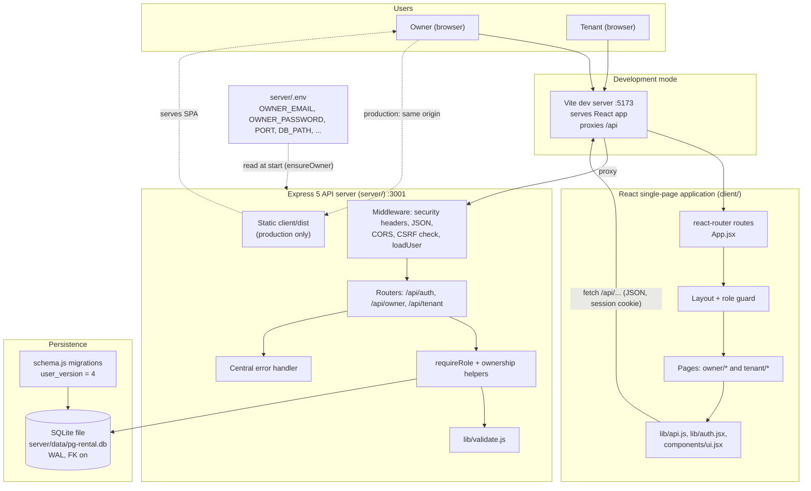

---

## 6. Database Design

All details below were read back from a database built by the project's own migrations (`PRAGMA table_info`, `foreign_key_list`, `sqlite_master`). `user_version = 4`.

### 6.1 Tables, columns and constraints

Types are SQLite declared types. Dates and timestamps are stored as `TEXT`.

**`users`** — owner and tenant accounts (one table, `role` column)

| Column | Type | Constraints |
|---|---|---|
| `id` | INTEGER | **PK** |
| `role` | TEXT | NOT NULL, CHECK in (`owner`,`tenant`) |
| `name` | TEXT | NOT NULL |
| `email` | TEXT | NOT NULL, **UNIQUE**, COLLATE NOCASE |
| `phone` | TEXT | nullable |
| `password_hash` | TEXT | NOT NULL (`scrypt$salt$key`; the value `!` means "cannot log in yet") |
| `owner_id` | INTEGER | **FK → users.id** ON DELETE CASCADE; for tenants = their owner, NULL for owners |
| `must_change_password` | INTEGER | NOT NULL DEFAULT 0 (legacy; never set to 1 by current code) |
| `created_at` | TEXT | NOT NULL DEFAULT `datetime('now')` |
| `registered_at` | TEXT | nullable; NULL = tenant added but not registered (added by migration 3) |

Table CHECK: `(role='owner' AND owner_id IS NULL) OR (role='tenant' AND owner_id IS NOT NULL)`. Index `idx_users_owner(owner_id)`.

**`sessions`** — server-side login sessions

| Column | Type | Constraints |
|---|---|---|
| `id` | INTEGER | **PK** |
| `token_hash` | TEXT | NOT NULL, **UNIQUE** (SHA-256 of the cookie token) |
| `user_id` | INTEGER | NOT NULL, **FK → users.id** ON DELETE CASCADE |
| `expires_at` | TEXT | NOT NULL (ISO timestamp) |
| `created_at` | TEXT | NOT NULL DEFAULT `datetime('now')` |

Index `idx_sessions_user(user_id)`.

**`properties`** — the PG (one per owner)

| Column | Type | Constraints |
|---|---|---|
| `id` | INTEGER | **PK** |
| `owner_id` | INTEGER | NOT NULL, **FK → users.id** ON DELETE CASCADE |
| `name`, `address`, `city` | TEXT | NOT NULL |
| `description` | TEXT | nullable |
| `created_at` | TEXT | NOT NULL DEFAULT `datetime('now')` |
| `total_floors` | INTEGER | NOT NULL DEFAULT 1, CHECK 1–50 (migration 3) |

Index `idx_properties_owner(owner_id)`; **trigger** `one_pg_per_owner`.

**`rooms`**

| Column | Type | Constraints |
|---|---|---|
| `id` | INTEGER | **PK** |
| `property_id` | INTEGER | NOT NULL, **FK → properties.id** ON DELETE **RESTRICT** |
| `room_number` | TEXT | NOT NULL; **UNIQUE (property_id, room_number)** (binary comparison; case-insensitive uniqueness is enforced by the API) |
| `capacity` | INTEGER | NOT NULL, CHECK 1–20 |
| `monthly_rent` | INTEGER | NOT NULL, CHECK ≥ 0 (rent per bed) |
| `notes` | TEXT | nullable |
| `created_at` | TEXT | NOT NULL DEFAULT `datetime('now')` |
| `floor` | INTEGER | NOT NULL DEFAULT 0, CHECK 0–49 (0 = ground; migration 3) |

**`tenancies`** — a tenant's stay in a room (history is kept)

| Column | Type | Constraints |
|---|---|---|
| `id` | INTEGER | **PK** |
| `tenant_id` | INTEGER | NOT NULL, **FK → users.id** ON DELETE RESTRICT |
| `room_id` | INTEGER | NOT NULL, **FK → rooms.id** ON DELETE RESTRICT |
| `start_date` | TEXT | NOT NULL |
| `end_date` | TEXT | nullable; CHECK `end_date IS NULL OR end_date >= start_date` |
| `monthly_rent` | INTEGER | NOT NULL, CHECK ≥ 0 (agreed rent for this stay) |
| `deposit` | INTEGER | NOT NULL DEFAULT 0, CHECK ≥ 0 |
| `status` | TEXT | NOT NULL DEFAULT `active`, CHECK in (`active`,`ended`) |
| `created_at` | TEXT | NOT NULL DEFAULT `datetime('now')` |
| `due_day` | INTEGER | NOT NULL DEFAULT 5, CHECK 1–28 (migration 2) |

Indexes: `idx_tenancies_room`, `idx_tenancies_tenant`, **`uq_tenancies_one_active`** (UNIQUE `tenant_id` WHERE `status='active'`).

**`payments`** — one monthly rent charge per stay per month

| Column | Type | Constraints |
|---|---|---|
| `id` | INTEGER | **PK** |
| `tenancy_id` | INTEGER | NOT NULL, **FK → tenancies.id** ON DELETE CASCADE |
| `period` | TEXT | NOT NULL, CHECK GLOB `YYYY-MM` shape (`[0-9]{4}-[0-1][0-9]`); the API additionally limits months to 01–12 |
| `amount_due` | INTEGER | NOT NULL, CHECK ≥ 0 |
| `amount_paid` | INTEGER | NOT NULL DEFAULT 0, CHECK ≥ 0 |
| `status` | TEXT | NOT NULL DEFAULT `pending`, CHECK in (`pending`,`partial`,`paid`) |
| `due_date` | TEXT | NOT NULL |
| `paid_on`, `method`, `note` | TEXT | nullable (last payment date / method / note) |
| `created_at` | TEXT | NOT NULL DEFAULT `datetime('now')` |

**UNIQUE (tenancy_id, period)**. (`amount_paid ≤ amount_due` and the `method` list are enforced by the API, not by the database.)

**`complaints`**

| Column | Type | Constraints |
|---|---|---|
| `id` | INTEGER | **PK** |
| `tenancy_id` | INTEGER | NOT NULL, **FK → tenancies.id** ON DELETE CASCADE |
| `title`, `description` | TEXT | NOT NULL |
| `category` | TEXT | NOT NULL DEFAULT `other`, CHECK in (electrical, plumbing, cleaning, internet, furniture, food, other) |
| `status` | TEXT | NOT NULL DEFAULT `open`, CHECK in (`open`,`in_progress`,`resolved`) |
| `owner_reply` | TEXT | nullable |
| `created_at`, `updated_at` | TEXT | NOT NULL DEFAULT `datetime('now')` |

Index `idx_complaints_tenancy`.

**`notices`**

| Column | Type | Constraints |
|---|---|---|
| `id` | INTEGER | **PK** |
| `property_id` | INTEGER | NOT NULL, **FK → properties.id** ON DELETE CASCADE |
| `title`, `body` | TEXT | NOT NULL |
| `created_at` | TEXT | NOT NULL DEFAULT `datetime('now')` |

Index `idx_notices_property`.

**`vacate_requests`** (migration 2)

| Column | Type | Constraints |
|---|---|---|
| `id` | INTEGER | **PK** |
| `tenancy_id` | INTEGER | NOT NULL, **FK → tenancies.id** ON DELETE CASCADE |
| `requested_date` | TEXT | NOT NULL |
| `reason`, `owner_note` | TEXT | nullable |
| `status` | TEXT | NOT NULL DEFAULT `pending`, CHECK in (pending, approved, rejected, cancelled) |
| `created_at` | TEXT | NOT NULL DEFAULT `datetime('now')` |
| `decided_at` | TEXT | nullable |

Indexes: `idx_vacate_tenancy`, **`uq_vacate_one_pending`** (UNIQUE `tenancy_id` WHERE `status='pending'`).

### 6.2 Relationships

| Parent → Child | Cardinality | Foreign key | On delete |
|---|---|---|---|
| users (owner) → users (tenants) | 1 : N | `users.owner_id` | CASCADE |
| users → sessions | 1 : N | `sessions.user_id` | CASCADE |
| users (owner) → properties | 1 : 0..1 *(trigger enforces one PG)* | `properties.owner_id` | CASCADE |
| properties → rooms | 1 : N | `rooms.property_id` | **RESTRICT** |
| properties → notices | 1 : N | `notices.property_id` | CASCADE |
| users (tenant) → tenancies | 1 : N *(at most one `active`)* | `tenancies.tenant_id` | **RESTRICT** |
| rooms → tenancies | 1 : N *(active count ≤ capacity, enforced by the API)* | `tenancies.room_id` | **RESTRICT** |
| tenancies → payments | 1 : N *(one per month)* | `payments.tenancy_id` | CASCADE |
| tenancies → complaints | 1 : N | `complaints.tenancy_id` | CASCADE |
| tenancies → vacate_requests | 1 : N *(at most one `pending`)* | `vacate_requests.tenancy_id` | CASCADE |

### 6.3 ER diagram

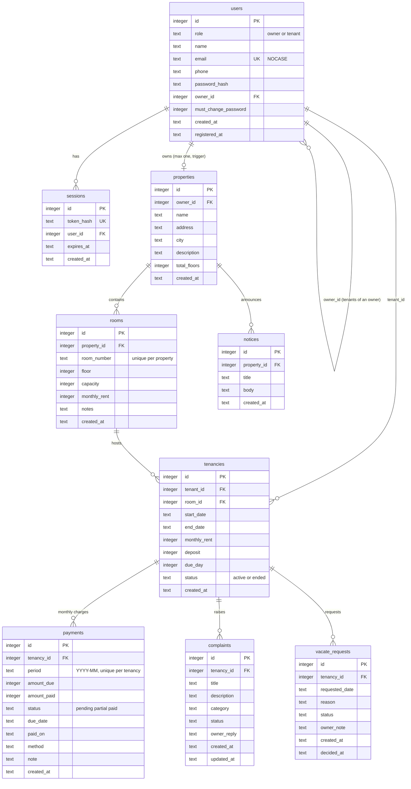

### 6.4 Indexes, uniqueness and trigger

| Object | Definition | Purpose |
|---|---|---|
| `idx_users_owner` | `users(owner_id)` | list an owner's tenants |
| `idx_sessions_user` | `sessions(user_id)` | delete/lookup a user's sessions |
| `idx_properties_owner` | `properties(owner_id)` | find an owner's PG |
| `idx_tenancies_room`, `idx_tenancies_tenant` | `tenancies(room_id)`, `(tenant_id)` | occupancy and stay lookups |
| `uq_tenancies_one_active` | UNIQUE `tenancies(tenant_id) WHERE status='active'` | a tenant has at most one active stay |
| `idx_complaints_tenancy`, `idx_notices_property`, `idx_vacate_tenancy` | on the FK column | joins |
| `uq_vacate_one_pending` | UNIQUE `vacate_requests(tenancy_id) WHERE status='pending'` | one pending move-out request per stay |
| `UNIQUE(property_id, room_number)` | table constraint | no duplicate room numbers within a PG |
| `UNIQUE(tenancy_id, period)` | table constraint | one rent charge per stay per month |
| `UNIQUE(users.email)` NOCASE, `UNIQUE(sessions.token_hash)` | column constraints | one account per e-mail; token lookup |
| Trigger `one_pg_per_owner` | `BEFORE INSERT ON properties WHEN EXISTS (SELECT 1 FROM properties WHERE owner_id = NEW.owner_id) → RAISE(ABORT, 'Each owner can manage only one PG')` | blocks a second PG for new inserts without touching existing rows |

### 6.5 Migrations (`server/src/schema.js`)

| Version | Lines | Content |
|---|---|---|
| 1 | `schema.js:4-107` | Creates `users`, `sessions`, `properties`, `rooms`, `tenancies`, `payments`, `complaints`, `notices` and their indexes |
| 2 | `:108-125` | Adds `tenancies.due_day`; creates `vacate_requests` |
| 3 | `:126-152` | Adds `properties.total_floors`, `rooms.floor`; creates trigger `one_pg_per_owner`; adds `users.registered_at` (back-filled from `created_at`); creates `registration_codes` (later removed) |
| 4 | `:153-157` | `DROP TABLE registration_codes` (e-mail verification removed). No user data touched |

Applied by `migrate()` (`:160-169`): each pending migration runs inside a transaction together with the `user_version` update.

### 6.6 How the tables support the workflows

| Workflow | Tables used |
|---|---|
| Login, registration, sessions | `users`, `sessions` |
| PG, floors, rooms, availability | `properties`, `rooms`, `tenancies` (count of active stays) |
| Add/assign/transfer/move-out tenant | `users` (tenant row), `tenancies`, `rooms` |
| Monthly rent and payments | `tenancies` (rent, due day), `payments` |
| Complaints | `complaints` → `tenancies` → `rooms` → `properties` |
| Notices | `notices` → `properties` |
| Move-out requests | `vacate_requests` → `tenancies` |

### 6.7 Observations about the schema *(for the Limitations section)*

* Rules that the **API enforces but the database does not**: room capacity vs occupants; case-insensitive room-number uniqueness; `amount_paid ≤ amount_due`; payment `method` values; date formats; calendar-valid `YYYY-MM`.
* Two timestamp formats coexist: `datetime('now')` defaults (`YYYY-MM-DD HH:MM:SS`, UTC) and ISO-8601 strings written by the application (`registered_at`, `sessions.expires_at`, …).
* `users.owner_id` (tenant → owner) duplicates information that can also be derived through `tenancies → rooms → properties`; the application keeps them consistent.
* Part payments are summarised in one row per month (no per-instalment table).

---

## 7. Data Flow Diagrams

### 7.1 Level 0 — context diagram

External entities: **Owner**, **Tenant**, and the **Deployer** (supplies the owner credentials through server configuration). The whole application is one process.

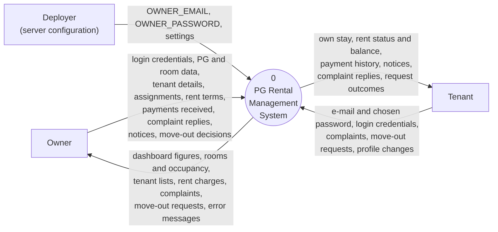

### 7.2 Level 1 data flow diagram

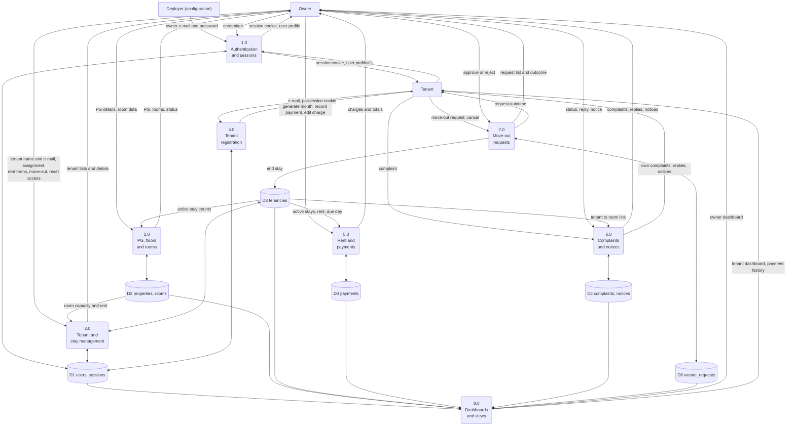

### 7.3 Explanation of the processes and flows

| Process | Implemented by | What it does | Data stores |
|---|---|---|---|
| 1.0 Authentication and sessions | `routes/auth.js` (`/login`, `/logout`, `/me`, `/profile`, `/change-password`), `lib/auth.js`, `lib/owner.js` | Verifies credentials, creates/destroys sessions, applies the single-owner rule; at start creates or updates the owner from configuration | D1 |
| 2.0 PG, floors and rooms | `routes/owner/properties.js` | Creates/edits the PG and floor count; creates/edits/deletes rooms; computes occupancy status | D2, reads D3 |
| 3.0 Tenant and stay management | `routes/owner/tenants.js` | Adds tenants, assigns/transfers rooms inside capacity limits, edits rent terms, moves out, resets access | D1, D3, reads D2 |
| 4.0 Tenant registration | `routes/auth.js:89` | Checks that the e-mail was added by the owner and not yet registered, stores the password hash, opens a session | D1 |
| 5.0 Rent and payments | `routes/owner/payments.js` | Generates monthly charges, records payments, edits/deletes charges, filters | D4, reads D3 |
| 6.0 Complaints and notices | `routes/tenant.js`, `routes/owner/complaints.js` | Tenant raises complaints; owner updates status/reply; owner posts notices; tenants read them | D5, reads D3 |
| 7.0 Move-out requests | `routes/tenant.js`, `routes/owner/vacate.js` | Tenant requests/cancels; owner approves (ends stay) or rejects | D6, writes D3 |
| 8.0 Dashboards and views | `routes/owner/index.js:14`, `routes/tenant.js:49-72` | Aggregates figures and lists for each role (owner-scoped / tenant-scoped) | reads D1–D6 |

---

## 8. Use Case Diagram

### 8.1 Actors

| Actor | Evidence |
|---|---|
| **Owner** | role `owner`; single account from configuration |
| **Tenant** | role `tenant`; account claimed through registration |
| **Visitor (not logged in)** | can only log in or register as a tenant (`App.jsx:45-47`) |

### 8.2 Use cases per actor

| Actor | Use cases |
|---|---|
| Visitor | Log in; Register tenant account (only with an owner-added e-mail) |
| Owner | Log out; Edit own profile; Set up PG details and floors; Add/edit/delete rooms; View room availability; Add tenant; Edit tenant details; Assign or transfer room; Change rent, due day and deposit; Move tenant out; Reset tenant access; Generate monthly rent charges; Record payment (full/part); Edit or delete a charge; View owner dashboard; Update complaints (status and reply); Post and delete notices; Approve or reject move-out request |
| Tenant | Log out; Edit own profile; Change password; View own stay dashboard; View own payment history and balance; Raise a complaint and track it; Read notices; Request move-out; Cancel own move-out request |

### 8.3 Diagram (Mermaid)

Mermaid has no native use-case diagram, so actors and use cases are drawn as a flowchart (rectangles = actors, ovals = use cases). PlantUML source follows for a conventional UML diagram.

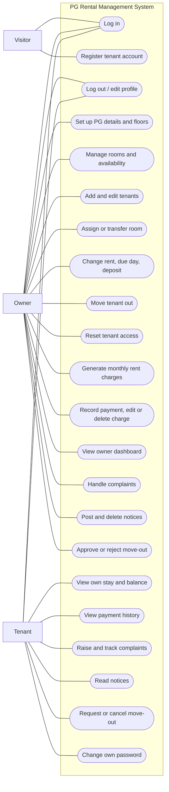

PlantUML source:

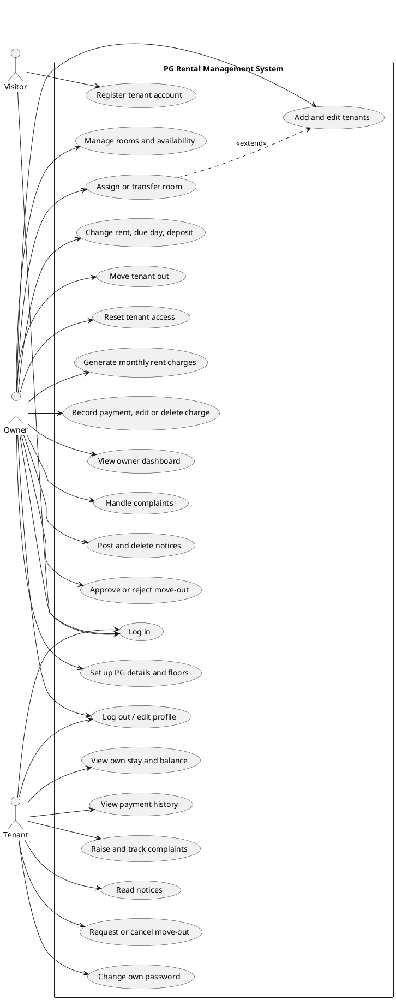

---

## 9. Class Diagram — why a conventional UML class diagram would be misleading

The backend and frontend are written almost entirely as **functions and ES modules**; the frontend uses **function components and hooks**. The only classes defined in the entire codebase are two small error types:

| Class | File | Purpose |
|---|---|---|
| `HttpError extends Error` | `server/src/lib/http.js:3` | carries an HTTP status and optional per-field `details`; turned into a JSON response by the error handler |
| `ApiError extends Error` | `client/src/lib/api.js:4` | client-side counterpart carrying `status` and `details` |

Drawing "classes" for users, rooms, payments, etc. would invent an object-oriented design that does not exist in the code. Three accurate views are provided instead.

### 9.1 The only real classes

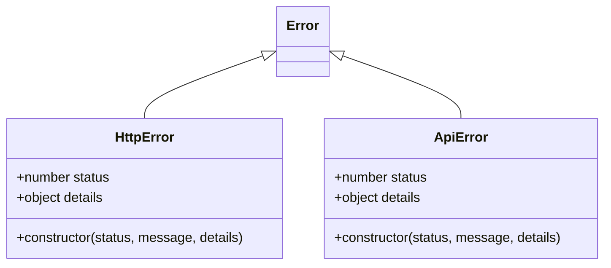

### 9.2 Module / component diagram (actual import structure)

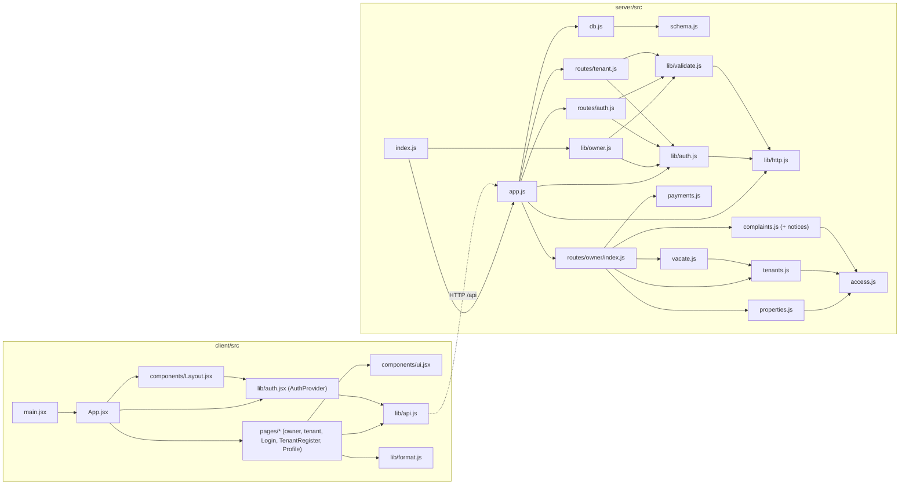

### 9.3 Domain model (derived from the database schema — *not* classes in the code)

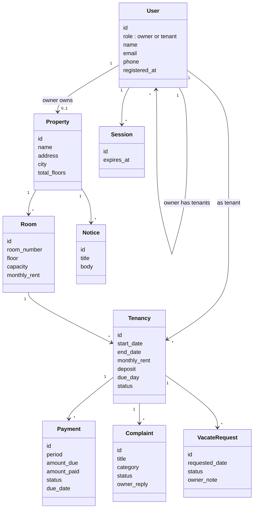

---

## 10. Sequence Diagrams

Only workflows that exist in the code are shown. `API` = Express app (`server/src/app.js`), `DB` = SQLite. Every request to `/api` first passes the middleware chain of §5.3 (CORS → CSRF origin check → `loadUser`); it is abbreviated in the diagrams.

### 10.1 Server start and owner bootstrap

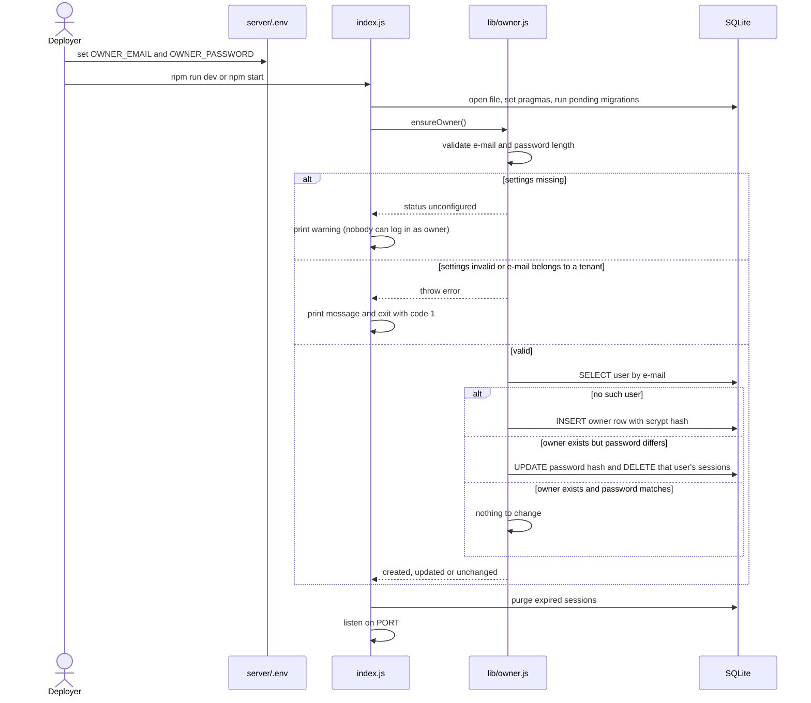

### 10.2 Owner login (and session restore)

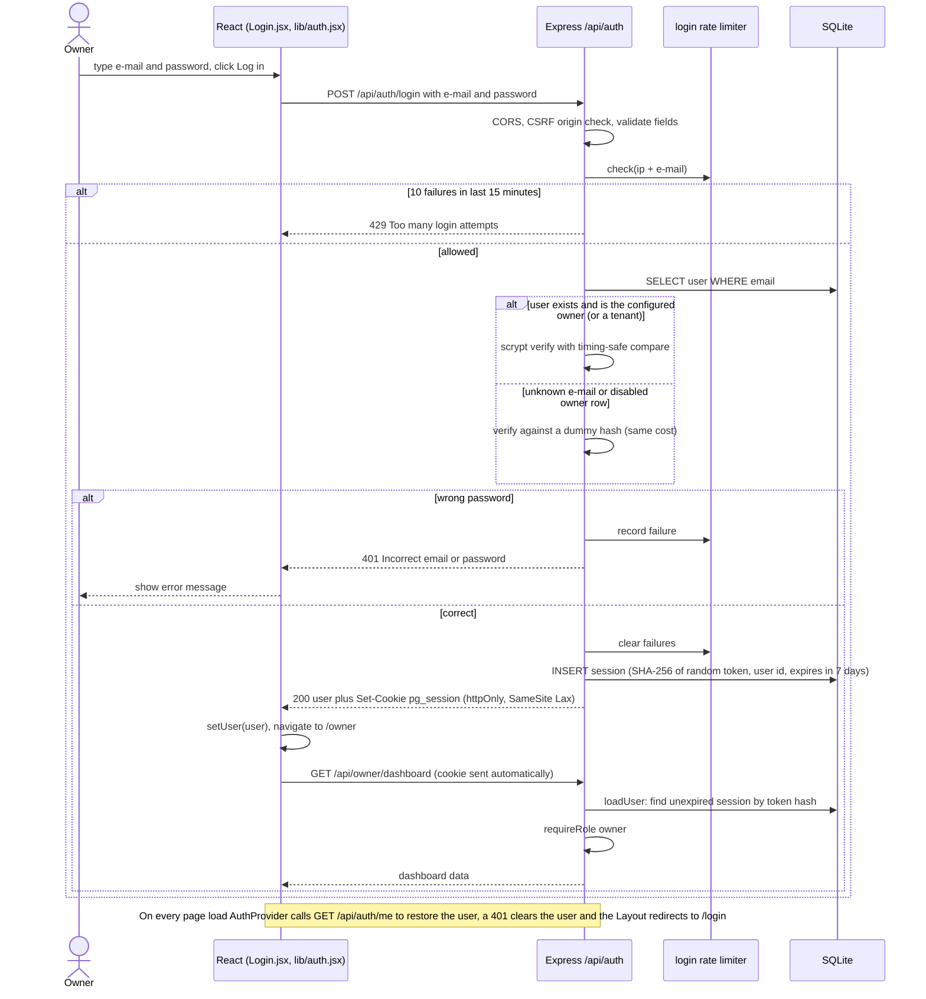

### 10.3 Tenant login

The endpoint, session handling and rate limit are identical to §10.2. The differences are the role-based redirect and what the server will accept afterwards.

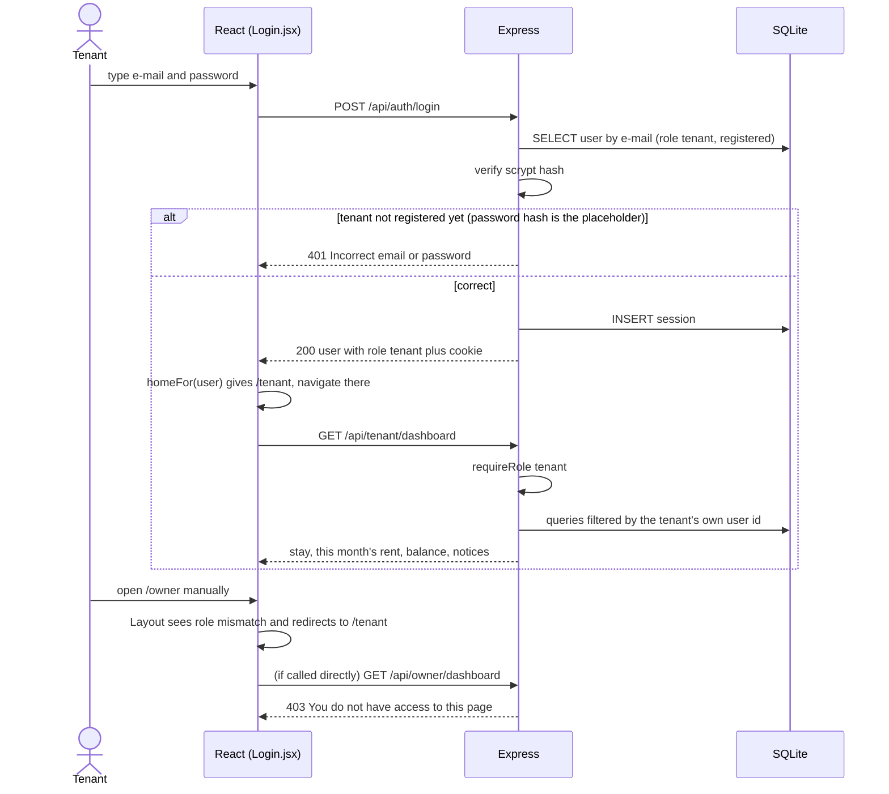

### 10.4 Tenant account registration

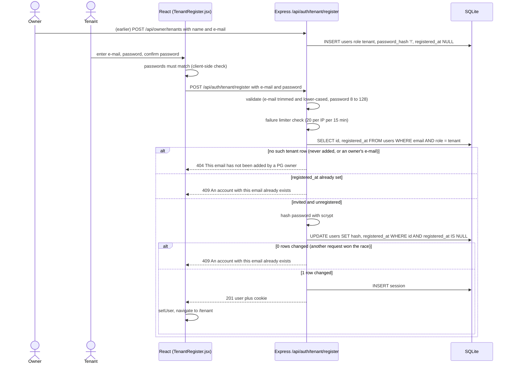

### 10.5 Adding a tenant and assigning a room (stay management)

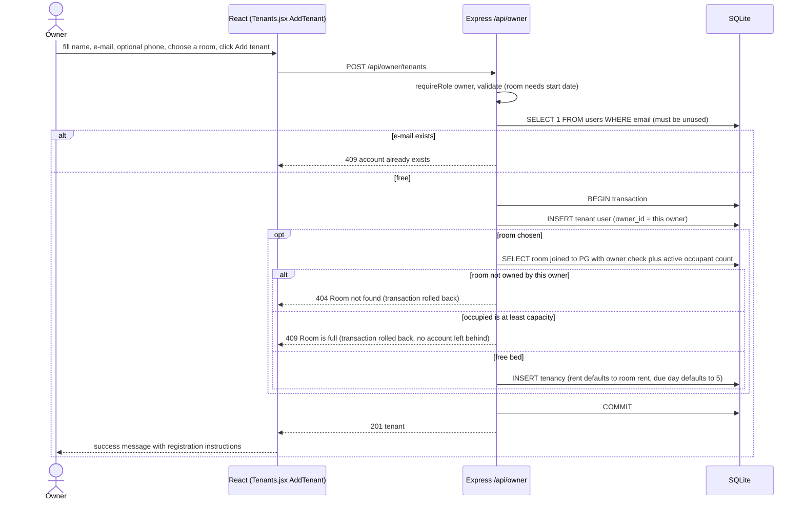

### 10.6 Monthly rent charges and payment recording

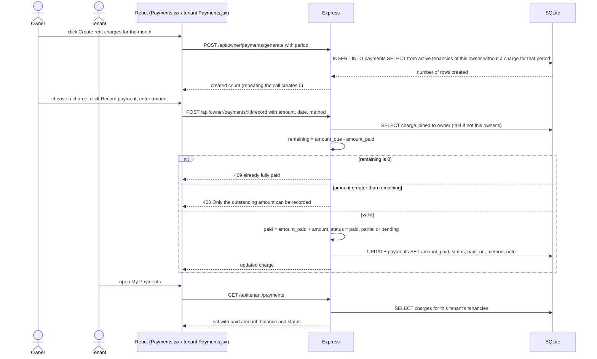

### 10.7 Move-out request and decision

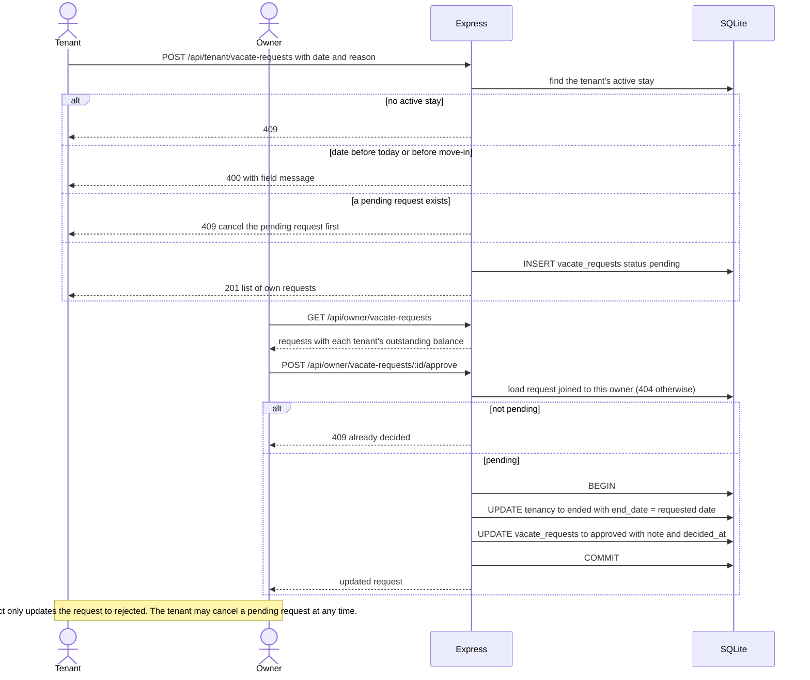

---

## 11. Algorithms and Methodology

> **Development methodology:** the repository does not record a process model (e.g. Agile, Waterfall, iterative). Describe the process your team actually followed; do not infer it from the code. What *can* be stated from the evidence is the technical method below.

### 11.1 Technical method (what the code does)

* **API-first, role-separated design:** one REST API with `/auth`, `/owner`, `/tenant` areas; UI pages are thin clients of those endpoints.
* **Server-side enforcement:** every rule is checked on the server even if the UI also checks it.
* **Validate → authorize → act → respond:** handlers validate input with `validate()`, resolve records through ownership helpers, perform SQL (inside a transaction when several writes are needed), and return a JSON body.
* **Schema evolution by migration:** SQL migrations appended over time; upgrade behaviour is tested.
* **Test-driven verification:** integration tests drive the real Express app over HTTP against an in-memory database.

### 11.2 Authentication

```text
login(email, password):
    data  = validate({email -> normalised, password -> text up to 128})
    key   = clientIP + "|" + email
    if failures(key) >= 10 within 15 minutes: return 429
    user  = SELECT * FROM users WHERE email = data.email
    if user exists AND (user.role is tenant OR user.email == OWNER_EMAIL):
        ok = scrypt_verify(password, user.password_hash)          # timing-safe
    else:
        scrypt_verify(password, DUMMY_HASH); ok = false            # same time cost
    if not ok: failures(key)++ ; return 401 "Incorrect email or password"
    reset failures(key)
    token = 32 random bytes (base64url)
    INSERT session(sha256(token), user.id, now + 7 days)
    set cookie pg_session = token (httpOnly, SameSite=Lax, Secure in production)
    return 200 {user: id, role, name, email, phone, mustChangePassword}
```
(`server/src/routes/auth.js:26-40`, `server/src/lib/auth.js`)

### 11.3 Password hashing and verification

```text
hash(plain):  salt = 16 random bytes; key = scrypt(plain, salt, 64 bytes)
              return "scrypt$" + hex(salt) + "$" + hex(key)
verify(plain, stored):
              split stored by "$"; if scheme != "scrypt": return false      # the placeholder "!" can never verify
              actual = scrypt(plain, salt_from_stored, length of stored key)
              return timingSafeEqual(stored key, actual)
```
(`auth.js:15-27`)

### 11.4 Session validation and authorization

```text
for every /api request:
    token = cookie "pg_session"
    user  = SELECT user FROM sessions JOIN users WHERE token_hash = sha256(token) AND expires_at > now
    if user is an owner and user.email != OWNER_EMAIL: user = none     # single-owner rule
    req.user = user (or none)                                          # loadUser never rejects
requireRole(role):  if no req.user -> 401 ; if req.user.role != role -> 403
owner data access:  SELECT ... WHERE id = :id AND owner is req.user.id ; if no row -> 404
tenant data access: every query is filtered by req.user.id
```
(`auth.js:86-118`, `routes/owner/access.js`, `routes/tenant.js`)

### 11.5 Owner bootstrap (`ensureOwner`)

```text
if OWNER_EMAIL and OWNER_PASSWORD both missing: return "unconfigured"
validate e-mail, password (8..128), optional name; else throw (server exits)
row = SELECT user WHERE email
if none:                 INSERT owner with hash(OWNER_PASSWORD)        -> "created"
elif row.role != owner:  throw "belongs to a tenant account"
elif verify(OWNER_PASSWORD, row.hash): "unchanged"
else: in one transaction UPDATE hash and DELETE the user's sessions     -> "updated"
```
(`server/src/lib/owner.js:15-52`)

### 11.6 Tenant registration (atomic claim)

```text
register(email, password):
    data = validate(email, password 8..128)
    if failures(ip) >= 20 within 15 min: 429
    t = SELECT id, registered_at FROM users WHERE email AND role = 'tenant'
    if none:               failures(ip)++ ; 404 "not added by a PG owner"
    if t.registered_at:    failures(ip)++ ; 409 "already exists"
    hash = scrypt_hash(password)
    n = UPDATE users SET password_hash = hash, registered_at = now
        WHERE id = t.id AND role = 'tenant' AND registered_at IS NULL      # atomic
    if n != 1: 409
    create session; return 201
```
(`routes/auth.js:89-117`) — the conditional `UPDATE` guarantees that, of several concurrent requests for one e-mail, exactly one succeeds (tested with 2 and 8 simultaneous requests).

### 11.7 Input validation

```text
validate(input, schema, {partial}):
    for each (field, rule) in schema:
        if partial and field absent in input: skip
        try value = rule(input[field]) ; keep value (blank optional fields become null)
        catch error: errors[field] = error.message
    if errors not empty: throw 400 {error: "Please correct the highlighted fields", details: errors}
    if partial and nothing kept: throw 400 "Nothing to update"
    return only the declared fields           # unknown fields (such as "role") are dropped
```
Rules: `str` (trim, min/max), `int` (whole number, range), `email` (trim, lower-case, pattern, ≤254), `phone`, `password` (8–128), `date` (real calendar date `YYYY-MM-DD`), `period` (`YYYY-MM`, month 01–12), `oneOf` (enum) — `server/src/lib/validate.js`.

### 11.8 Room capacity, availability and floors

```text
occupied(room) = COUNT(tenancies WHERE room_id = room.id AND status = 'active')
status(room)   = 'vacant' if occupied == 0 ; 'full' if occupied >= capacity ; else 'partial'
placeInRoom(owner, tenant, data):                       # runs inside a transaction
    room = owned room (404 if not this owner's)
    if room.occupied >= room.capacity: 409 "Room is full"
    INSERT tenancy(rent = data.rent or room.monthly_rent, deposit = data.deposit or 0, due_day = data.due_day or 5)
createRoom: floor defaults to 0; require floor < property.total_floors (else 400);
            reject if another room has the same number ignoring case (409)
updateRoom: capacity may not drop below current occupants (409)
changeFloorCount(n): reject if n <= highest floor that has rooms (409)
```
(`tenants.js:60-67`, `properties.js:26-45,56-63,144-158,170-175`). Because `better-sqlite3` is synchronous and the check and insert run in one transaction, two requests cannot both take the last bed.

### 11.9 Assigning, transferring and moving out

```text
assign(tenant, room, start_date, ...):                  # one transaction
    current = active tenancy of tenant
    if current:
        if current.room == room: 409 ; if start_date < current.start_date: 400
        endTenancy(current, end = start_date)           # old stay ends the day the new one starts
    placeInRoom(...)                                    # capacity check as above
endTenancy(id, date): UPDATE tenancy SET status='ended', end_date=date ;
                      UPDATE vacate_requests SET status='cancelled' WHERE tenancy=id AND status='pending'
moveOut(tenant, end_date = today): current must exist (409) ; end_date >= current.start_date (400) ; endTenancy
resetAccess(tenant): one transaction: password_hash='!', registered_at=NULL, DELETE sessions
```
(`routes/owner/tenants.js:70-75,122-181`). History rows are never deleted; the database `uq_tenancies_one_active` index backs "one active stay".

### 11.10 Rent charge generation and payment status

```text
generate(period = this month):
    last_day = last calendar day of period
    INSERT INTO payments(tenancy_id, period, amount_due, due_date)
    SELECT t.id, period, t.monthly_rent, period || '-' || two-digit(t.due_day)
    FROM tenancies t of this owner
    WHERE t.status = 'active' AND t.start_date <= last_day
      AND NOT EXISTS (a payment for t and period)       # idempotent; UNIQUE(tenancy_id, period) is the safety net
    return number of rows inserted

record(payment, amount):
    remaining = amount_due - amount_paid
    if remaining <= 0: 409 ; if amount > remaining: 400
    paid = amount_paid + amount
    status = 'paid' if paid >= amount_due else 'partial' if paid > 0 else 'pending'
    UPDATE amount_paid, status, paid_on (default today), method (kept if not given), note (kept if not given)

edit(payment, new_due, new_due_date, note): new_due may not be less than amount_paid ; status recomputed
delete(payment): refused if amount_paid > 0

balance (tenant, owner dashboards) = SUM(amount_due - amount_paid) over the relevant charges
month_collected = SUM(amount_paid) for charges of the current period
overdue = charges with status != 'paid' AND due_date < today (dashboard shows the 8 oldest)
```
(`routes/owner/payments.js:24,43-102`, `routes/owner/index.js:30-38,65-74`, `routes/tenant.js:53`). Rent changes made later affect only charges generated afterwards (`tenants.js:152-153` comment; tested).

### 11.11 Move-out request workflow

```text
request(tenant, date, reason):
    stay = active tenancy (409 if none)
    date must be >= today and >= stay.start_date (400)
    at most one pending request per stay (409; also enforced by uq_vacate_one_pending)
    INSERT status 'pending'
cancel: UPDATE status='cancelled' WHERE id AND status='pending' AND tenancy belongs to this tenant (404 otherwise)
approve(owner, request):                                 # one transaction
    request must be pending (409) and requested_date >= stay.start_date (400)
    endTenancy(request.tenancy, request.requested_date)  # also marks pending requests cancelled ...
    UPDATE request SET status='approved', owner_note, decided_at   # ... and then this request becomes approved
reject: pending only -> status 'rejected' with note
```
(`routes/tenant.js:109-139`, `routes/owner/vacate.js:36-60`). Note: approving ends the stay **immediately in the database** with the requested date as `end_date` (there is no separate "notice period" state).

### 11.12 Cross-origin and CSRF decision

```text
for every /api request:
    CORS: if no Origin header or Origin is in the allow-list -> allow with credentials ; else no CORS headers
    if method is not GET/HEAD/OPTIONS and an Origin header exists:
        if Origin in allow-list: continue
        elif Origin's host equals the request Host: continue
        else 403 "Cross-site request blocked"
```
Allow-list = `CLIENT_ORIGINS`, or `http://localhost:5173` and `http://127.0.0.1:5173` outside production, or empty in production (`app.js:33-69`).

### 11.13 Rate limiting

```text
limiter(max, window): map key -> {first, count}
check(key):  if entry exists and now - first < window and count >= max: throw 429
fail(key):   start a new window if none/expired else count++ ; prune old entries when the map exceeds 10,000
clear(key):  delete
```
Used for login (10 / 15 min per IP+e-mail) and tenant registration failures (20 / 15 min per IP) — `lib/auth.js:135-162`, `routes/auth.js:85`. State is in process memory.

### 11.14 Business rules summary

| Rule | Where enforced |
|---|---|
| Exactly one owner account, from configuration | `lib/owner.js`, `lib/auth.js:96-97,103`, login `routes/auth.js:32` |
| One PG per owner | API `properties.js:84-86` + DB trigger `one_pg_per_owner` |
| Room numbers unique per PG (ignoring case) | `properties.js:39-45` (+ DB UNIQUE, binary) |
| Floor must exist in the PG; floors cannot shrink below used floors | `properties.js:30-36,56-63` |
| Never more active tenants than beds | `tenants.js:62`; `properties.js:170-172` |
| A tenant has one active stay | DB `uq_tenancies_one_active`; transfer ends the old stay |
| One rent charge per stay per month | DB `UNIQUE(tenancy_id, period)`; `NOT EXISTS` in generator |
| A payment cannot exceed the outstanding amount; a charge cannot drop below what is paid | `payments.js:67-71,89-93` |
| A charge with money recorded cannot be deleted | `payments.js:106` |
| A room with tenancy history cannot be deleted | `properties.js:183-184` |
| Only owner-added e-mails can register; one registration per e-mail | `routes/auth.js:93-113` |
| A registered tenant's e-mail cannot be changed by the owner | `tenants.js:109-111` |
| Complaints and move-out requests only while a stay is active | `tenant.js:89,111` |
| One pending move-out request per stay; date ≥ today and ≥ move-in | `tenant.js:113-121`; DB `uq_vacate_one_pending` |

---

## 12. Implementation Details

Representative code is quoted from the repository; paths and line numbers are those of the analysed working tree.

### 12.1 Server bootstrap, configuration and error handling

* **Purpose:** start the server, prepare the owner account, apply middleware, map errors to JSON.
* **Files:** `server/src/index.js`, `server/src/app.js`, `server/src/db.js`, `server/src/lib/http.js`, `server/src/lib/owner.js`.
* **Frontend ↔ backend:** in development `client/vite.config.js:9-11` proxies `/api`; in production `app.js:84-92` serves `client/dist` and falls back to `index.html` for client-side routes.
* **Environment variables referenced in code (names only):** `OWNER_EMAIL`, `OWNER_PASSWORD`, `OWNER_NAME`, `PORT`, `DB_PATH`, `NODE_ENV`, `CLIENT_ORIGINS`, `TRUST_PROXY` (server), `VITE_API_URL` (client). `server/.env.example` documents these.
* **Error handling:** central handler `app.js:96-111`.

```js
// server/src/app.js:96-111 (abridged)
app.use((err, req, res, next) => {
  let status = err.status || err.statusCode || 500;
  let message = err.message;
  if (err.type === 'entity.parse.failed') message = 'Request body is not valid JSON';
  else if (err.code === 'SQLITE_CONSTRAINT_TRIGGER') [status, message] = [409, err.message];
  else if (err.code === 'SQLITE_CONSTRAINT_UNIQUE') [status, message] = [409, 'That record already exists'];
  else if (err.code === 'SQLITE_CONSTRAINT_FOREIGNKEY') [status, message] = [409, 'This record is linked to other records ...'];
  else if (status >= 500 && !(err instanceof HttpError)) { console.error(err); message = 'Something went wrong on the server'; }
  res.status(status).json({ error: message, ...(err.details && { details: err.details }) });
});
```

### 12.2 Database layer and migrations

* **Purpose:** open SQLite, enforce integrity, evolve the schema safely.
* **Files:** `server/src/db.js`, `server/src/schema.js`.
* **Operations:** direct prepared SQL through `better-sqlite3` in route files; multi-step writes use `db.transaction(...)`.

```js
// server/src/db.js:13-18
const db = new Database(dbPath);
db.pragma('journal_mode = WAL');
db.pragma('foreign_keys = ON');
db.pragma('busy_timeout = 5000');
migrate(db);

// server/src/schema.js:161-169
export function migrate(db, upTo = migrations.length) {
  const current = db.pragma('user_version', { simple: true });
  for (let v = current; v < upTo; v++) {
    db.transaction(() => { db.exec(migrations[v]); db.pragma(`user_version = ${v + 1}`); })();
  }
}
```

### 12.3 Authentication and sessions

* **Files:** `server/src/lib/auth.js`, `server/src/routes/auth.js`, `client/src/lib/auth.jsx`, `client/src/pages/Login.jsx`, `client/src/lib/api.js`.
* **DB operations:** `users` (lookup), `sessions` (insert, lookup by hash, delete).
* **Errors:** 401 "Incorrect email or password" (identical for unknown e-mail / wrong password / disabled owner); 429 on rate limit.

```js
// server/src/lib/auth.js:15-27  password hashing and verification (verbatim)
export async function hashPassword(plain) {
  const salt = crypto.randomBytes(16);
  const key = await scrypt(plain, salt, KEY_LEN);
  return `scrypt$${salt.toString('hex')}$${key.toString('hex')}`;
}
export async function verifyPassword(plain, stored) {
  const [scheme, saltHex, keyHex] = String(stored).split('$');
  if (scheme !== 'scrypt' || !saltHex || !keyHex) return false;
  const expected = Buffer.from(keyHex, 'hex');
  const actual = await scrypt(plain, Buffer.from(saltHex, 'hex'), expected.length);
  return crypto.timingSafeEqual(expected, actual);
}

// server/src/lib/auth.js:42-57  session creation (abridged: the hash is stored, never the token)
const token = crypto.randomBytes(32).toString('base64url');
db.prepare('INSERT INTO sessions (token_hash, user_id, expires_at) VALUES (?, ?, ?)')
  .run(sha256(token), userId, expires.toISOString());
res.cookie(SESSION_COOKIE, token, { httpOnly: true, sameSite: 'lax', secure: isProduction, expires, path: '/' });

// server/src/lib/auth.js:99-118  loading the user and role guard (blank lines removed)
export function loadUser(req, res, next) {
  const token = readCookie(req, SESSION_COOKIE);
  const user = token ? findSessionUser.get(sha256(token), new Date().toISOString()) : null;
  req.user = user && mayUseApp(user) ? user : null;
  next();
}
export function requireRole(role) {
  return (req, res, next) => {
    if (!req.user) return next(new HttpError(401, 'Please log in'));
    if (req.user.role !== role) return next(new HttpError(403, 'You do not have access to this page'));
    next();
  };
}
```

**Frontend side.** `client/src/lib/api.js:22-40` is the only place that calls `fetch`; a 401 (other than from login) triggers `onUnauthorized`, which clears the user so `Layout.jsx:37-40` redirects to `/login`.

### 12.4 Tenant registration

* **Files:** `server/src/routes/auth.js:78-117`, `client/src/pages/TenantRegister.jsx`, owner side `server/src/routes/owner/tenants.js:77-104`.
* **DB:** `users` (insert placeholder row; conditional update), `sessions`.
* **Errors:** 400 (invalid e-mail / password length), 404 (not added), 409 (already registered / lost race), 429 (rate limit). The client shows the message and per-field errors, and checks "passwords match" before sending.

```js
// server/src/routes/auth.js:104-113  atomic claim of an invited account
const hash = await hashPassword(data.password);
const claimed = db.prepare(
  `UPDATE users SET password_hash = ?, registered_at = ?, must_change_password = 0
   WHERE id = ? AND role = 'tenant' AND registered_at IS NULL`,
).run(hash, new Date().toISOString(), tenant.id);
if (claimed.changes !== 1) throw alreadyRegistered();
```

### 12.5 PG, floors and rooms

* **Files:** `server/src/routes/owner/properties.js`, `client/src/pages/owner/PgDetails.jsx`, `client/src/pages/owner/Rooms.jsx`.
* **DB:** `properties`, `rooms`, `tenancies` (occupancy count).
* **Interaction:** `Rooms.jsx` calls `GET /owner/pg` once, groups rooms by floor in the browser, and posts room changes to `/owner/pg/rooms` and `/owner/rooms/:id`.

```js
// server/src/routes/owner/properties.js:26,30-36  availability and floor rule
export const roomStatus = (r) => (r.occupied === 0 ? 'vacant' : r.occupied >= r.capacity ? 'full' : 'partial');
function checkFloor(property, floor) {
  if (floor >= property.total_floors) throw badRequest('Please correct the highlighted fields', {
    floor: `This PG has ${property.total_floors} floor(s). Increase the number of floors in PG Details first.` });
}
```

### 12.6 Tenants and stays

* **Files:** `server/src/routes/owner/tenants.js`, `client/src/pages/owner/Tenants.jsx`, `TenantDetail.jsx`.
* **DB:** `users`, `tenancies`, `rooms`, `vacate_requests`, `sessions`.

```js
// server/src/routes/owner/tenants.js:60-67  capacity enforcement (called inside a transaction)
function placeInRoom(ownerId, tenantId, data) {
  const room = ownedRoom(ownerId, data.room_id);
  if (room.occupied >= room.capacity) throw conflict(`Room ${room.room_number} is full`);
  db.prepare(`INSERT INTO tenancies (tenant_id, room_id, start_date, monthly_rent, deposit, due_day)
              VALUES (?, ?, ?, ?, ?, ?)`)
    .run(tenantId, room.id, data.start_date, data.monthly_rent ?? room.monthly_rent, data.deposit ?? 0, data.due_day ?? 5);
}
```

### 12.7 Rent and payments

* **Files:** `server/src/routes/owner/payments.js`, `client/src/pages/owner/Payments.jsx`, `client/src/pages/tenant/Payments.jsx`.
* **DB:** `payments`, `tenancies`.

```js
// server/src/routes/owner/payments.js:46-54  one statement creates all missing charges
const result = db.prepare(
  `INSERT INTO payments (tenancy_id, period, amount_due, due_date)
   SELECT t.id, @period, t.monthly_rent, @period || '-' || printf('%02d', t.due_day)
   FROM tenancies t JOIN rooms r ON r.id = t.room_id JOIN properties p ON p.id = r.property_id
   WHERE p.owner_id = @owner_id AND t.status = 'active' AND t.start_date <= @last_day
     AND NOT EXISTS (SELECT 1 FROM payments x WHERE x.tenancy_id = t.id AND x.period = @period)`,
).run({ owner_id: req.user.id, period: p, last_day: lastDay });

// server/src/routes/owner/payments.js:67-76  recording a (partial) payment
const remaining = payment.amount_due - payment.amount_paid;
if (remaining <= 0) throw conflict('This rent is already fully paid');
if (data.amount > remaining) throw badRequest('Please correct the highlighted fields', { amount: `Only ₹${remaining} is outstanding` });
const paid = payment.amount_paid + data.amount;
db.prepare(`UPDATE payments SET amount_paid = ?, status = ?, paid_on = ?, method = COALESCE(?, method), note = COALESCE(?, note) WHERE id = ?`)
  .run(paid, statusFor(payment.amount_due, paid), data.paid_on ?? today(), data.method, data.note, payment.id);
```

### 12.8 Complaints, notices and move-out

* **Files:** `server/src/routes/tenant.js`, `server/src/routes/owner/complaints.js`, `server/src/routes/owner/vacate.js`; pages `tenant/Complaints.jsx`, `owner/Complaints.jsx`, `owner/Notices.jsx`, `tenant/Notices.jsx`, `tenant/Vacate.jsx`, `owner/VacateRequests.jsx`.
* **DB:** `complaints`, `notices`, `vacate_requests`, `tenancies`.

```js
// server/src/routes/owner/vacate.js:43-48  approval is atomic
db.transaction(() => {
  endTenancy(request.tenancy_id, request.requested_date);
  db.prepare("UPDATE vacate_requests SET status = 'approved', owner_note = ?, decided_at = datetime('now') WHERE id = ?")
    .run(owner_note, request.id);
})();
```

### 12.9 Dashboards

* **Files:** `server/src/routes/owner/index.js:14-91`, `server/src/routes/tenant.js:49-63`; `client/src/pages/owner/Dashboard.jsx`, `client/src/pages/tenant/Dashboard.jsx`.
* Each dashboard is **one API call** returning pre-aggregated figures (owner: properties, rooms, beds, occupied beds, month due/collected, total outstanding, missing charges, open complaints, pending move-outs, overdue list, recent complaints).

### 12.10 Validation module

```js
// server/src/lib/validate.js:6-22 (re-formatted onto fewer lines, logic unchanged)
export function validate(input, schema, { partial = false } = {}) {
  const body = input && typeof input === 'object' ? input : {};
  const out = {}; const errors = {};
  for (const [key, rule] of Object.entries(schema)) {
    if (partial && !(key in body)) continue;
    try { const value = rule(body[key]); if (value !== undefined) out[key] = value; }
    catch (err) { errors[key] = err.message; }
  }
  if (Object.keys(errors).length) throw badRequest('Please correct the highlighted fields', errors);
  if (partial && !Object.keys(out).length) throw badRequest('Nothing to update');
  return out;
}
```

### 12.11 Frontend infrastructure

* **Files:** `client/src/lib/api.js`, `client/src/lib/auth.jsx`, `client/src/lib/format.js` (₹ currency formatting `en-IN`, date and floor labels), `client/src/components/ui.jsx`, `client/src/components/Layout.jsx`.

```jsx
// client/src/components/Layout.jsx:37-40  client-side guard (convenience, not security)
if (checking) return <Loading label="Checking your session…" />;
if (!user) return <Navigate to="/login" replace state={{ from: location.pathname }} />;
if (user.role !== role) return <Navigate to={homeFor(user)} replace />;
if (user.mustChangePassword && location.pathname !== profilePath) return <Navigate to={profilePath} replace />;
```

### 12.12 Seed script (development only)

`server/scripts/seed.js` uses the configured owner, refuses to run in production, and creates demo PG "Sunrise PG" (3 floors, 5 rooms), 4 registered demo tenants, 1 invited tenant, sample payments, 1 complaint and 1 notice. Demo tenant passwords are documented in `README.md` (not repeated here).

---

## 13. API Documentation

**49 endpoints** were derived from the route definitions (`app.js`, `routes/auth.js`, `routes/tenant.js`, `routes/owner/*.js`). Base path `/api`. Bodies are JSON (`Content-Type: application/json`, limit 100 kB). All paths in the tables are relative to `/api`.

### 13.1 Conventions that apply to every endpoint

| Topic | Behaviour |
|---|---|
| Authentication | Cookie `pg_session` (httpOnly). "Session" below means a valid, unexpired session. |
| Error body | `{ "error": "message" }`, plus `"details": { "field": "message" }` for field-level validation errors (`app.js:110`). |
| `400` | Validation failed, invalid JSON (`Request body is not valid JSON`), or a rule violation with field details. A *partial* update with no recognised fields returns `Nothing to update`. |
| `401` | No valid session (`Please log in`). |
| `403` | Wrong role (`You do not have access to this page`) or a cross-site write (`Cross-site request blocked`). |
| `404` | Unknown API route (`API route not found`), or a record that does not exist **or belongs to someone else** (ownership is not revealed). Non-numeric ids return 404. |
| `409` | Conflict: duplicate, rule violation, or SQLite unique / foreign-key / trigger constraint (`app.js:101-104`). |
| `413` | Body larger than 100 kB (raised by Express; not covered by a test). |
| `429` | Rate limit (login, tenant registration). |
| `500` | Unexpected error: generic message, details logged on the server only. |
| Ownership | "Owner-scoped" endpoints look records up through `ownedProperty/ownedRoom/ownedTenant` or a join on `properties.owner_id`, so they return 404 for another owner's data. |

### 13.2 System and authentication endpoints

| Method | Endpoint | Purpose | Auth | Role | Request fields | Response | Error cases | Source |
|---|---|---|---|---|---|---|---|---|
| GET | `/health` | Check server and DB | none | any | — | `200 {status:'ok', database:{connected, sqliteVersion}}` | `500` if the DB call throws | `app.js:73` |
| POST | `/auth/login` | Log in (owner or tenant) | none | any | `email`, `password` (≤128) | `200 {user:{id, role, name, email, phone, mustChangePassword}}` + `Set-Cookie pg_session` | `400` validation; `401 Incorrect email or password` (also for unregistered tenants and disabled owner rows); `429` after 10 failures per IP+e-mail in 15 min | `routes/auth.js:26` |
| POST | `/auth/logout` | End the session | none required | any | — | `200 {ok:true}`; cookie cleared | — | `routes/auth.js:42` |
| GET | `/auth/me` | Current user | Session | any | — | `200 {user}` | `401` | `routes/auth.js:47` |
| PATCH | `/auth/profile` | Edit own name/phone | Session | any | `name` (2–100), `phone` (optional) — partial | `200 {user}` | `400` invalid / nothing to update; `401` | `routes/auth.js:52` |
| POST | `/auth/change-password` | Change own password | Session | **tenant** (owner → 403) | `currentPassword`, `newPassword` (8–128) | `200 {ok:true}`; other sessions of the user are deleted | `400` wrong current password / same password / weak password; `403` owner; `401` | `routes/auth.js:60` |
| POST | `/auth/tenant/register` | Create a tenant account for an owner-added e-mail | none | public | `email`, `password` (8–128) | `201 {user}` + `Set-Cookie` | `400` validation; `404` e-mail not added by an owner; `409` already registered or lost a race; `429` after 20 failures per IP in 15 min | `routes/auth.js:89` |

### 13.3 Tenant endpoints (`requireRole('tenant')`, `routes/tenant.js:9`)

Every query is filtered by the logged-in tenant's id. Errors common to all: `401`, `403` (owner or anonymous cannot use them).

| Method | Endpoint | Purpose | Request fields | Response | Specific error cases | Source |
|---|---|---|---|---|---|---|
| GET | `/tenant/dashboard` | Overview | — | `{stay, thisMonth, balanceDue, notices (≤5), openComplaints, vacateRequest}`; `stay` is `null` without an active stay | — | `tenant.js:49` |
| GET | `/tenant/payments` | Own rent charges | — | `{payments:[{id, period, amount_due, amount_paid, status, due_date, paid_on, method, note, room_number, property_name}]}` newest first | — | `tenant.js:65` |
| GET | `/tenant/notices` | Notices of the current PG | — | `{notices}` (empty when no stay) | — | `tenant.js:69` |
| GET | `/tenant/complaints` | Own complaints | — | `{complaints}` | — | `tenant.js:74` |
| POST | `/tenant/complaints` | Raise a complaint | `title` (3–150), `description` (5–2000), `category?` ∈ electrical, plumbing, cleaning, internet, furniture, food, other (default `other`) | `201 {complaint}` | `400` validation; `409` no active stay | `tenant.js:87` |
| GET | `/tenant/vacate-requests` | Own move-out requests | — | `{requests}` | — | `tenant.js:105` |
| POST | `/tenant/vacate-requests` | Request to move out | `requested_date` (`YYYY-MM-DD`, today or later and not before move-in), `reason?` (≤500) | `201 {requests}` | `400` date rules; `409` no active stay or a request is already pending | `tenant.js:109` |
| POST | `/tenant/vacate-requests/:id/cancel` | Cancel own pending request | — | `200 {requests}` | `404` if not pending / not own | `tenant.js:130` |

### 13.4 Owner endpoints (`requireRole('owner')`, `routes/owner/index.js:12`)

Errors common to all: `401` (not logged in), `403` (tenant), `404` (foreign or missing record).

**Dashboard, PG and rooms** (`routes/owner/index.js`, `routes/owner/properties.js`)

| Method | Endpoint | Purpose | Request fields | Response | Specific error cases | Source |
|---|---|---|---|---|---|---|
| GET | `/owner/dashboard` | Owner overview | — | `{period, stats:{properties, rooms, total_beds, occupied_beds, month_due, month_collected, total_outstanding, missing_charges, open_complaints, pending_vacates}, overdue[≤8], recentComplaints[≤5]}` | — | `owner/index.js:14` |
| GET | `/owner/pg` | The owner's PG with rooms | — | `{pg, rooms}` (`pg:null, rooms:[]` before setup); each room has `occupied`, `status`, `tenants[]` ordered by floor | — | `properties.js:198` |
| PUT | `/owner/pg` | Create (first time) or update the PG | `name` (2–100), `address` (3–300), `city` (2–100), `description?` (≤2000), `total_floors?` (1–50); update is partial | `201 {pg}` on create, `200 {pg}` on update | `400` validation; `409` lowering floors below the highest floor that has rooms | `properties.js:216` |
| POST | `/owner/pg/rooms` | Add a room to the PG | `room_number` (≤20), `capacity` (1–20), `monthly_rent` (0–10,000,000), `floor?` (0–49, default 0), `notes?` (≤500) | `201 {room}` | `404` PG not set up; `400` floor ≥ PG floors or validation; `409` duplicate room number (case-insensitive) | `properties.js:234` |
| GET | `/owner/rooms` | All rooms with occupancy | — | `{rooms}` with `property_name`, `occupied`, `status` | — | `properties.js:132` |
| PATCH | `/owner/rooms/:id` | Edit a room | any of the room fields (partial) | `200 {room}` | `400` floor/validation; `409` capacity below current occupants or duplicate number | `properties.js:165` |
| DELETE | `/owner/rooms/:id` | Delete a room | — | `200 {ok:true}` | `409` room has tenancy history | `properties.js:181` |
| GET | `/owner/properties` | *(legacy)* list properties with bed counts | — | `{properties}` | — | `properties.js:65` |
| POST | `/owner/properties` | *(legacy)* create the PG | property fields | `201 {property}` | `409` owner already has a PG | `properties.js:82` |
| GET | `/owner/properties/:id` | *(legacy)* PG with rooms | — | `{property, rooms}` | — | `properties.js:96` |
| PATCH | `/owner/properties/:id` | *(legacy)* update PG | property fields (partial) | `{property}` | `409` floors below used floor | `properties.js:112` |
| DELETE | `/owner/properties/:id` | *(legacy)* delete PG | — | `{ok:true}` | `409` while it still has rooms | `properties.js:121` |
| POST | `/owner/properties/:id/rooms` | *(legacy)* add room to a PG | room fields | `201 {room}` | as `/owner/pg/rooms` | `properties.js:160` |

**Tenants and stays** (`routes/owner/tenants.js`)

| Method | Endpoint | Purpose | Request fields | Response | Specific error cases | Source |
|---|---|---|---|---|---|---|
| GET | `/owner/tenants` | List tenants | query `status` ∈ active, past, all (default all) | `{tenants:[{id, name, email, phone, registered_at, room_id, room_number, property_name, monthly_rent, deposit, due_day, start_date, balance_due}]}` | `400` bad status | `tenants.js:23` |
| GET | `/owner/tenants/:id` | Tenant details | — | `{tenant, tenancies[], payments[]}` | — | `tenants.js:32` |
| POST | `/owner/tenants` | Add a tenant (and optionally a stay) | `name` (2–100), `email`, `phone?`, `room_id?`; if `room_id`: `start_date` (required), `monthly_rent?`, `deposit?`, `due_day?` (1–28) | `201 {tenant}` | `409` e-mail already used (any account) or room full; `404` room not owned; `400` validation. Atomic: nothing is created on failure | `tenants.js:79` |
| PATCH | `/owner/tenants/:id` | Edit tenant | `name?`, `email?`, `phone?` (partial) | `200 {tenant}` | `409` e-mail already used, or changing the e-mail of a registered tenant | `tenants.js:106` |
| POST | `/owner/tenants/:id/reset-access` | Lock out and require re-registration | — | `200 {tenant}` | — | `tenants.js:122` |
| POST | `/owner/tenants/:id/assign` | Assign or transfer to a room | `room_id`, `start_date`, `monthly_rent?`, `deposit?`, `due_day?` | `200 {tenant}` | `409` same room / room full; `400` start date before current stay's start; `404` room not owned | `tenants.js:133` |
| PATCH | `/owner/tenants/:id/tenancy` | Change rent, due day, deposit of the active stay | `monthly_rent?`, `due_day?` (1–28), `deposit?` (partial) | `200 {tenant}` | `409` no active stay | `tenants.js:154` |
| POST | `/owner/tenants/:id/move-out` | End the active stay | `end_date?` (default today) | `200 {tenant}` | `409` no active stay; `400` end date before move-in | `tenants.js:168` |

**Payments** (`routes/owner/payments.js`)

| Method | Endpoint | Purpose | Request fields | Response | Specific error cases | Source |
|---|---|---|---|---|---|---|
| GET | `/owner/payments` | List charges | query `period?` (`YYYY-MM`), `status?` ∈ pending, partial, paid, unpaid, `tenant_id?` | `{payments}` (each with tenant, room and PG names) | `400` bad filter | `payments.js:26` |
| POST | `/owner/payments/generate` | Create the month's charges | `period?` (default current month) | `200 {created, period}` (`created` = 0 when everything exists) | `400` bad period | `payments.js:43` |
| POST | `/owner/payments/:id/record` | Record money received | `amount` (1–10,000,000), `paid_on?`, `method?` ∈ cash, upi, bank_transfer, card, other, `note?` (≤300) | `200 {payment}` with updated status | `409` already fully paid; `400` amount above outstanding | `payments.js:59` |
| PATCH | `/owner/payments/:id` | Edit a charge | `amount_due?`, `due_date?`, `note?` (partial) | `200 {payment}` | `400` amount below what is already paid | `payments.js:81` |
| DELETE | `/owner/payments/:id` | Delete a charge | — | `200 {ok:true}` | `409` money already recorded | `payments.js:104` |

**Complaints, notices, move-out** (`routes/owner/complaints.js`, `routes/owner/vacate.js`)

| Method | Endpoint | Purpose | Request fields | Response | Specific error cases | Source |
|---|---|---|---|---|---|---|
| GET | `/owner/complaints` | List complaints | query `status?` ∈ open, in_progress, resolved | `{complaints}` open first | `400` bad status | `complaints.js:22` |
| PATCH | `/owner/complaints/:id` | Update status / reply | `status?`, `owner_reply?` (≤2000) | `200 {complaint}` | `400` nothing to update | `complaints.js:30` |
| GET | `/owner/notices` | List notices | — | `{notices}` newest first | — | `complaints.js:49` |
| POST | `/owner/notices` | Post a notice | `property_id`, `title` (2–150), `body` (≤5000) | `201 {notice}` | `404` property not owned; `400` validation | `complaints.js:59` |
| DELETE | `/owner/notices/:id` | Delete a notice | — | `200 {ok:true}` | `404` | `complaints.js:72` |
| GET | `/owner/vacate-requests` | List move-out requests | — | `{requests}` pending first, each with tenant, room and `balance_due` | — | `vacate.js:28` |
| POST | `/owner/vacate-requests/:id/approve` | Approve (ends the stay) | `owner_note?` (≤500) | `200 {request}` | `409` not pending; `400` requested date before move-in | `vacate.js:36` |
| POST | `/owner/vacate-requests/:id/reject` | Reject | `owner_note?` | `200 {request}` | `409` not pending | `vacate.js:52` |

> **Observation (for limitations):** the six *legacy* property endpoints are not called by the current UI (`client/src` has no call to `/owner/properties`), but they remain reachable and are exercised by tests.
> The API has no versioning, no OpenAPI/Swagger document and no pagination.

---

## 14. Testing and Results

### 14.1 Test framework and approach

| Item | Detail |
|---|---|
| Framework | Node.js built-in test runner (`node:test`) with `node:assert/strict` — no third-party test library |
| Command | `npm test` (root) → `npm test -w server` → `node --test "test/**/*.test.js"` (`server/package.json`) |
| Type of tests | **Backend integration tests**: each file starts the real Express app on a random port (`app.listen(0)`) and calls it with `fetch`, using a small cookie-keeping client, against an **in-memory SQLite database** (`DB_PATH=':memory:'` is set before the app is imported) |
| Shared helpers | `server/test/helpers.js`: `registerTenant`, `createOwner`, `asOwner`, `signInOwner` |
| Frontend tests | **None** (no React testing library, no browser-test framework in the repository) |
| Coverage report | **None** (no coverage tool configured; no report exists) |
| CI configuration | **None** found |

### 14.2 Actual results (executed during this analysis)

| Item | Result |
|---|---|
| Date / environment | 2026-10-13, Windows, Node.js v24.21.0, npm 11.19.0 |
| Command run | `npm test -- --test-reporter=spec` |
| **Tests** | **147** |
| Suites | 36 |
| **Passed** | **147** |
| Failed | 0 |
| Cancelled / skipped / todo | 0 / 0 / 0 |
| Duration | ≈ 3.24 s (`duration_ms 3242`) |
| Real database | Not touched: its file fingerprint was identical before and after the run |
| Production build | `npm run build` succeeded: 44 modules transformed, ≈0.4 s; output `index-*.js` 328.66 kB (98.49 kB gzip), `index-*.css` 22.91 kB (5.26 kB gzip) |

These numbers come from the run performed for this analysis. They are **not** a statement about browser behaviour (see §14.5).

### 14.3 Test cases (suites, counts and expected results)

| File | Suite | Tests | What is verified (expected result) |
|---|---|---|---|
| `api.test.js` (32) | authentication | 7 | Protected routes → 401; configured owner can log in (role `owner`, no hash in response); owner sign-up → 404; wrong password → 401; cross-origin write → 403; invalid JSON → 400 |
| | owner: properties and rooms | 4 | Create property and rooms; duplicate room → 409; another owner cannot read/change them (404); property with rooms cannot be deleted |
| | owner: tenants | 5 | Create tenant with room; full room → 409 and no account left; foreign room → 404; other owner cannot see tenant; capacity cannot drop below occupants |
| | tenant experience | 7 | Unregistered tenant cannot log in; registration then password change; role separation (403); dashboard shows stay; complaint raised and answered; notices only for the tenant's PG; profile edit ignores `role` |
| | payments | 3 | Generate charges is idempotent; part then full payment, overpayment rejected; owner dashboard numbers |
| | move out and transfers | 6 | Transfer ends the old stay; move-out validation; room with history not deletable; reset-access ends session and password; logout; unknown API route → JSON 404 |
| `cors.test.js` (5) | CORS | 5 | Preflight approved with credentials for the dev origin; request from dev origin reaches the route; other origins get no CORS headers and 403 on writes; origin never `*`; same-origin requests work |
| `owner-config.test.js` (22) | configuring the owner | 3 | Startup creates exactly one owner with a hashed password; repeat start changes nothing |
| | owner login | 5 | Predefined credentials work; e-mail case-insensitive; wrong password and unknown e-mail look identical; password never sent to browser; owner cannot change password in-app but can edit name/phone |
| | no way to become an owner | 3 | Sign-up endpoints give 404/401; no request creates an owner row; owner API refuses non-owners |
| | tenants still register with an owner-added email | 5 | Invited tenant registers and is kept out of owner data; uninvited e-mail → 404 and no account; owner e-mail cannot register; reset-access flow |
| | changing the configured password | 1 | New `OWNER_PASSWORD` replaces the old, ends old sessions |
| | existing databases | 2 | An existing owner row with the configured e-mail is adopted with its data; other owner rows are disabled but kept |
| | bad configuration | 3 | Weak/malformed settings stop startup; owner e-mail cannot be a tenant's; with no owner configured nobody can log in as owner |
| `pg-setup.test.js` (26) | PG details (one PG per owner) | 8 | No PG before setup; validation; create with 3 floors; second save updates; second PG refused by API **and** by the DB trigger; owners isolated; auth required |
| | floors and rooms | 9 | Rooms on floors, ordered; invalid floors rejected; duplicates refused across floors/case/spaces; same numbers allowed in another PG; renaming rules; floor count cannot shrink below used floors; cross-owner edits → 404 |
| | capacity limits | 6 | Status vacant → partial → full; full room refuses tenants without leaving accounts; single-bed rooms; transfers into full rooms refused; capacity floor; deletion rules |
| | only owners manage the PG | 1 | A tenant gets 403 on PG endpoints |
| | upgrading an existing database | 2 | Migrating a v2 database with data keeps all rows; legacy owner with several properties keeps working |
| `registration.test.js` (24) | setup | 2 | Owner adds tenants; verification-code endpoints and table no longer exist |
| | an invited tenant registers directly | 6 | 201 with e-mail + password only; own dashboard; owner API → 403; password hashed; login after logout; owner sees "registered" |
| | email matching | 3 | Case/space-insensitive; near-miss e-mails rejected; malformed e-mail → 400 with field message |
| | who is refused | 4 | Unknown e-mail → 404; duplicate registration → 409 and first password stays; owner e-mail refused; extra `role` field ignored |
| | passwords | 3 | <8 chars refused (invitation stays usable); >128 refused; same password gets different salted hashes |
| | concurrent requests | 2 | 2 and 8 simultaneous registrations → exactly one success, no duplicate accounts |
| | owner controls | 3 | Other owner/tenant cannot reset access; e-mail edit rules; reset access forces re-registration |
| | abuse protection | 1 | 30 uninvited attempts from one IP → 429 |
| `tenant-accounts.test.js` (25) | setup | 1 | Two owners with PGs and rooms |
| | who may create tenants | 5 | 401 / 403 / foreign room 404; each owner lists only own tenants; owner link stored correctly |
| | invalid input | 9 | Missing/short/malformed name, e-mail, phone, dates, rent, deposit, due day; non-existent room; non-object body; nothing created |
| | duplicate emails | 4 | Case-insensitive duplicates across tenants and owners → 409 |
| | a tenant added without a room | 4 | Optional phone/room; placeholder hash cannot log in; after registering sees empty stay; owner login unaffected |
| | secrets are never exposed | 2 | No password data in read responses; stored hashes are scrypt |
| `workflows.test.js` (13) | setup | 1 | Owners and two registered tenants |
| | rent amounts and due dates | 5 | Charges use each stay's rent and due day; later rent changes do not rewrite old charges; due-date edit and validation; tenant sees only own balance/history; part payment updates balance |
| | vacate requests | 7 | Validation; one pending request; owner view with balance; reject; cancel; approve ends stay and frees bed; manual move-out cancels request |

### 14.4 What the tests do **not** cover *(verified by searching the tests)*

* The React UI (pages, forms, routing guards) — no automated UI tests.
* Login rate limiting (10 per 15 min) — only the registration limiter is tested.
* `DELETE /owner/payments/:id`, `DELETE /owner/notices/:id`, the payments `status`/`tenant_id` filters and the complaints `status` filter.
* Response headers (CSP, `X-Frame-Options`), cookie flags, session expiry after 7 days, the hourly purge.
* Server start-up/shutdown (`index.js`), the seed script, the production static-file serving and SPA fallback.
* Performance, load, accessibility, cross-browser and mobile behaviour.

### 14.5 Known bugs, inconsistencies and limitations found while analysing

No functional defect was found by the 147 tests. The following are **observations**, labelled by how they were established:

| # | Observation | Basis |
|---|---|---|
| 1 | Stale test title: `api.test.js:198` still says "registers with an **emailed code**" although the code feature was removed (the test body uses direct registration). | Verified |
| 2 | Legacy flag: `must_change_password` is read by the UI but never set to 1 by the server; the "Temporary password" label in `Profile.jsx` is unreachable in practice. | Verified (grep) |
| 3 | Six legacy `/owner/properties*` endpoints exist but the UI does not use them. | Verified |
| 4 | Test-design caveats: the multi-owner tests switch `OWNER_EMAIL` in `process.env` between requests (`helpers.js:24`) and the 429 test in `registration.test.js:244` relies on in-process, IP-wide limiter state, so it is intentionally the last test. | Verified |
| 5 | Part payments are stored as a running total; the history of individual instalments is not kept. | Verified (§3.2) |
| 6 | Rent generation only bills stays that are `active` **when the button is pressed**; there is no proration and past months for tenants who have since left are not billed. | Verified (`payments.js:51`; no `end_date` logic) |
| 7 | Approving a move-out marks the stay `ended` at once, even if the requested date is in the future (the end date is stored, but the status changes immediately). | Verified (`vacate.js:43-48`) |
| 8 | "Today" and "current month" are computed in **UTC on the server** (`lib/http.js:22-28`) and in **local time in the browser** (`client/src/lib/format.js:18-23`). For users east of UTC (e.g. India) they differ during the first hours after local midnight; effects were **not tested**. | Code reading |
| 9 | The database does not enforce several rules the API enforces (see §6.7). | Verified |
| 10 | In-memory rate limiters reset on restart; sessions of a user are not revoked at a new login. | Verified |

### 14.6 Suggested additional tests *(not implemented)*

1. UI tests for login redirect by role, the route guard, form validation messages and the add-tenant flow (e.g. a component-test library plus a browser-automation tool).
2. Login rate-limit test (11th wrong attempt → 429; success clears the counter).
3. API tests for `DELETE` payments/notices and the remaining list filters.
4. Header/cookie tests (`Set-Cookie` flags in production mode, CSP presence).
5. Session expiry test (insert an expired session and expect 401) and purge test.
6. Migration tests from each historical version (v1→v4) with realistic data.
7. Boundary tests: 20-bed rooms, 50 floors, 28th due day, leap-year months, month-end rent generation.
8. Time-zone tests for `today()` / current period around local midnight.
9. Load test of the dashboard and list endpoints with a realistic data volume.
10. Accessibility checks (keyboard navigation, screen-reader labels) and mobile layout checks.

---

## 15. Screenshots and User Interface

### 15.1 Availability

**No screenshots exist in the repository** and none are embedded here. (During development sessions, temporary headless-browser captures of demo data were produced outside the repository; they are not project deliverables and should not be used.) Take fresh screenshots from a running application using the checklist in §15.3.

### 15.2 Pages and workflows (route → component → API)

| Route | Component (file) | Role | Shows / does | API calls |
|---|---|---|---|---|
| `/` | `Home` (`App.jsx:23`) | any | redirects to `/login` or the role's home | `GET /auth/me` (restore) |
| `/login` | `pages/Login.jsx` | public | login form; link "Tenant? Register here" | `POST /auth/login` |
| `/register/tenant` | `pages/TenantRegister.jsx` | public | Email, Choose a password, Confirm password, Create my account, Log in link | `POST /auth/tenant/register` |
| `/owner` | `pages/owner/Dashboard.jsx` | owner | setup guidance, "+ Add Tenant", stats, overdue rent, open complaints, pending move-outs | `GET /owner/dashboard`, `POST /owner/payments/generate` |
| `/owner/pg` | `PgDetails.jsx` | owner | Step 1: PG name, address, city, floors | `GET/PUT /owner/pg` |
| `/owner/rooms` | `Rooms.jsx` | owner | Step 2: one card per floor, rooms with status, add/edit/delete | `GET /owner/pg`, `POST /owner/pg/rooms`, `PATCH/DELETE /owner/rooms/:id` |
| `/owner/tenants` | `Tenants.jsx` | owner | Step 3: tenant list with tabs; Add tenant dialog; success instructions | `GET /owner/tenants`, `GET /owner/rooms`, `POST /owner/tenants` |
| `/owner/tenants/:id` | `TenantDetail.jsx` | owner | details, rent and stay history; edit, assign/change room, rent & due date, move out, reset access | `GET /owner/tenants/:id`, `PATCH …`, `POST …/assign`, `PATCH …/tenancy`, `POST …/move-out`, `POST …/reset-access` |
| `/owner/payments` | `Payments.jsx` | owner | month/status filters, charges table, record payment, edit/delete charge | `GET/POST/PATCH/DELETE /owner/payments…` |
| `/owner/complaints` | `Complaints.jsx` | owner | complaint cards, update status/reply | `GET`, `PATCH /owner/complaints…` |
| `/owner/vacate-requests` | `VacateRequests.jsx` | owner | approve/reject with outstanding balance shown | `GET`, `POST …/approve`, `…/reject` |
| `/owner/notices` | `Notices.jsx` | owner | post/delete notices | `GET/POST/DELETE /owner/notices`, `GET /owner/pg` |
| `/owner/profile`, `/tenant/profile` | `pages/Profile.jsx` | both | name/phone; password form for tenants; note for owner | `PATCH /auth/profile`, `POST /auth/change-password` |
| `/tenant` | `pages/tenant/Dashboard.jsx` | tenant | "My Stay": room, owner contact, rent status, balance, notices, pending move-out | `GET /tenant/dashboard` |
| `/tenant/payments` | `pages/tenant/Payments.jsx` | tenant | own charges and balance | `GET /tenant/payments` |
| `/tenant/complaints` | `pages/tenant/Complaints.jsx` | tenant | raise and track complaints | `GET/POST /tenant/complaints` |
| `/tenant/vacate` | `pages/tenant/Vacate.jsx` | tenant | request/cancel move-out, request history | `GET/POST /tenant/vacate-requests`, `POST …/cancel` |
| `/tenant/notices` | `pages/tenant/Notices.jsx` | tenant | notices of the PG | `GET /tenant/notices` |
| `*` | `NotFound` (`App.jsx:29`) | any | "Page not found" | — |

### 15.3 Screenshot checklist (capture these yourself; none are provided)

Use a development database with the demo data (`npm run seed`) or your own sample data. Hide or blur real names/e-mails in any screenshot.

| # | Screen | State to capture | Report use |
|---|---|---|---|
| 1 | Login page | empty; and with "Incorrect email or password" | Implementation / Results |
| 2 | Tenant registration | empty; each validation message (invalid e-mail, uninvited e-mail, password mismatch, short password, duplicate) | Implementation |
| 3 | Owner dashboard | first-run guidance banner; and populated with stats/overdue/complaints | Results |
| 4 | PG Details | empty setup; saved | Implementation |
| 5 | Floors & Rooms | several floors with Vacant/Partly filled/Full badges; Add room dialog; duplicate-room error | Results |
| 6 | Tenants list | tabs, "Registered" and "Invited, not registered" badges | Results |
| 7 | Add tenant dialog and success dialog | with room dropdown showing "FULL" disabled option | Implementation |
| 8 | Tenant detail | rent history, stay history; Assign room, Rent & due date, Move out dialogs | Results |
| 9 | Rent & Payments | generated charges; Record payment dialog; part-paid row | Results |
| 10 | Owner Complaints, Move-out Requests, Notices | one of each with a reply/decision | Results |
| 11 | Owner "My Account" | note that the password is configured on the server | Implementation |
| 12 | Tenant dashboard ("My Stay") | with balance and notices | Results |
| 13 | Tenant My Payments, Complaints, Move Out, Notices | one each | Results |
| 14 | 404 page and access redirect | tenant opening `/owner` ends on tenant home | Results |
| 15 | Mobile width | sidebar "Menu" button and one page | Usability |
| 16 | Terminal: server start | shows `Owner account …` and port (hide secrets) | Implementation |
| 17 | Terminal: `npm test` | 147 passing | Testing |
| 18 | Terminal: `npm run build` | build success | Testing |
| 19 | Database schema view | e.g. a SQLite viewer showing the 9 tables | Design |
| 20 | Diagrams in this file | render the Mermaid/PlantUML diagrams to images | Design |

---

## 16. Applications, Advantages, Limitations and Future Scope

### 16.1 Applications *(realistic uses of the implemented functionality)*

* Day-to-day management of one PG, hostel or small boarding house by its owner: occupancy, tenants, monthly rent, complaints, announcements, move-outs.
* A self-service portal for tenants to see their own dues and raise issues.
* A teaching/reference implementation of a role-based full-stack application (React + Express + SQLite) with server-side authorization and migrations.

### 16.2 Advantages *(each backed by the code or tests cited above)*

* One shared, structured record instead of scattered notes; tenants and owner see the same facts according to their role.
* Rules enforced on the server: capacity, unique room numbers, one charge per month, no over-payment, one active stay, one pending move-out request.
* Secure-by-default basics: hashed passwords, hashed session tokens, httpOnly cookies, role checks, owner scoping, rate limiting, CSRF/CORS control.
* Safe evolution: versioned migrations; upgrades preserve data (tested).
* Simple deployment: one Node process and one database file; the built client can be served by the same server.
* Verified behaviour: 147 automated tests pass.

### 16.3 Limitations

**Actual limitations (verified in code):**

1. One owner and one PG per deployment (by design); no staff or additional roles.
2. No e-mail verification, notifications or self-service password recovery; a registration link is claimed by the first person to submit an owner-added e-mail (documented trade-off).
3. No online payments, invoices, receipts, export or reports; part payments are stored as a running total only.
4. Rent charges are generated manually, only for stays active at that moment, without proration or late fees.
5. Move-out approval ends the stay immediately even for a future date.
6. No pagination, search or sorting controls on list endpoints.
7. Rate limiting and its counters live in memory (reset on restart; not shared across processes).
8. No automated frontend tests, coverage reports, CI, lint configuration or backup procedure.
9. Some leftovers: unused legacy property endpoints, an unused `must_change_password` path.
10. Some business rules are enforced only in the API, not in the database (§6.7).
11. Owner password is a plain-text deployment setting in `.env` and cannot be changed from the UI.
12. TLS/HTTPS is not handled by the app; the `Secure` cookie flag depends on `NODE_ENV=production`.
13. Limited accessibility features; no internationalisation (currency formatting is `en-IN`/₹ only).

**Potential limitations (assessment, not demonstrated):**

* Behaviour under heavy concurrent load or with very large data volumes (never measured).
* SQLite as a single-file database may limit multi-server deployment.
* UTC/local date differences near midnight (see §14.5 item 8).

### 16.4 Future scope *(ideas only — none of these is implemented)*

* E-mail/SMS notifications, e-mail verification and self-service password reset.
* Online payments with receipts/invoices and a per-instalment ledger.
* Scheduled automatic monthly rent generation, proration and late fees.
* Multiple PGs / multiple owners / staff roles; audit log.
* Reports and export (CSV/PDF); search, filters and pagination.
* Document upload (ID proof, rental agreement); deposit-refund tracking; utility billing.
* Frontend and end-to-end tests, CI pipeline, coverage; backup/restore automation.
* A mobile application or installable web app; accessibility audit and localisation.

---

## 17. References and Appendix

### 17.1 Existing documentation in the repository

| Document | Content |
|---|---|
| `README.md` | Setup, owner configuration table, workflow description, demo data, run/build/test commands, notes |
| `server/.env.example`, `client/.env.example` | Names and meaning of configuration variables (no secrets) |
| Source comments | Most modules start with explanatory comments (e.g. `server/src/lib/owner.js:5-14`, `server/src/app.js:30-32`) |
| This analysis | `PROJECT_ANALYSIS.md`, `PROJECT_REPORT_CHECKLIST.md` |

No design documents, API specification, user manual, test plan, or report text exists in the repository.

### 17.2 Dependencies to reference *(installed versions)*

Node.js 24.21.0 (project requires ≥ 22) · npm 11.19.0 · React 19.3.0 · React DOM 19.3.0 · react-router 7.18.4 · Vite 8.3.4 · @vitejs/plugin-react 6.1.2 · Tailwind CSS 4.3.3 (+ @tailwindcss/vite 4.3.3) · Express 5.3.0 · better-sqlite3 13.0.3 · cors 2.8.6 · concurrently 10.0.6.

### 17.3 Suggested official sources *(names only — open each site, find the exact page, and record the access date; no URLs or paper details were invented)*

| Topic | Source to consult |
|---|---|
| Node.js APIs used (`crypto.scrypt`, `crypto.randomBytes`, `timingSafeEqual`, built-in test runner `node:test`, `--env-file`) | Official Node.js documentation (nodejs.org) |
| Express routing, middleware order, error handling, behind-proxy settings | Express documentation (expressjs.com) |
| React components, hooks, context | React documentation (react.dev) |
| Client-side routing | React Router documentation (reactrouter.com) |
| Build tooling and dev-server proxy | Vite documentation (vite.dev) |
| Styling | Tailwind CSS documentation (tailwindcss.com) |
| SQLite features used: WAL, foreign keys, CHECK constraints, partial indexes, triggers, `PRAGMA user_version` | SQLite documentation (sqlite.org) |
| `better-sqlite3` API (prepared statements, transactions) | The package's official repository/README |
| Cookies, CORS, CSP, `fetch`, HTTP status codes | MDN Web Docs (developer.mozilla.org) |
| Password storage, session management, CSRF prevention | OWASP Cheat Sheet Series (owasp.org) — confirm the exact cheat-sheet titles before citing |
| scrypt specification | IETF RFC 7914 |
| HTTP cookies; HTTP semantics | IETF RFC 6265; RFC 9110 |
| Diagram notation | Mermaid documentation (mermaid.js.org); PlantUML documentation (plantuml.com) |

### 17.4 Appendix checklist

| Appendix item | Where to find it | Status |
|---|---|---|
| A. Database schema (DDL) | `server/src/schema.js` (print or paste, lines 3-158) | Available |
| B. Table/column dictionary | §6.1 of this file | Available |
| C. ER diagram | §6.3 (Mermaid) | Available — render to an image |
| D. API reference table | §13 | Available |
| E. Architecture, DFD, use case, module and sequence diagrams | §5.6, §7, §8, §9, §10 | Available — render to images |
| F. Selected source code | §12 snippets; suggested full listings: `server/src/lib/auth.js`, `server/src/routes/auth.js`, `server/src/routes/owner/payments.js`, `server/src/routes/owner/tenants.js`, `server/src/routes/owner/properties.js`, `client/src/lib/api.js`, `client/src/components/Layout.jsx` | Available |
| G. Test listing and output | §14.3; run `npm test` to capture the console output | Available — capture screenshot |
| H. Configuration reference | `server/.env.example` (names), `README.md` table | Available |
| I. Seed/demo data description | `server/scripts/seed.js` | Available |
| J. User screenshots | §15.3 | **Missing — to be captured** |
| K. Team, institution, guide, dates, acknowledgements | — | **Missing — supplied by you** |
